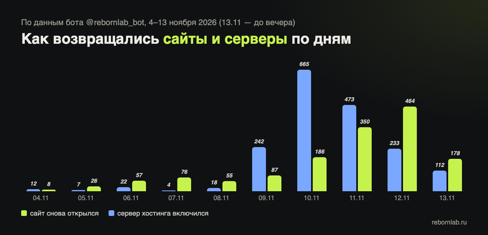

Вечером 4 ноября, когда тысячи сайтов на Beget перестали открываться, я сделал простую вещь: Telegram-бота, которому можно прислать адрес сайта, а он будет проверять его каждые 10 минут и напишет, как только сайт снова откроется. Без регистрации, без оплаты и без рекламы. Мне казалось, что самое тяжёлое в такой ситуации — не знать, что происходит.

Прошло десять дней. Вот что из этого получилось.

> **Коротко.** Бот сделан за вечер на Python и Telegram Bot API. За 10 дней — 1 108 человек, 1 229 вернувшихся сайтов и 1 570 сообщений «снова работает». Самое сложное оказалось не проверять сайты, а не врать людям: не присылать ложных тревог и не будить ночью. Ниже — цифры, устройство и ошибки, на которых мы учились.

## Главные цифры

| Что | Сколько |
|---|---|
| Людей воспользовались ботом | **1 108** |
| Сайтов вернулось, пока бот за ними следил | **1 229** |
| Из них переехали на другой хостинг | **262** |
| Сообщений «🎉 ваш сайт снова работает» | **1 570** |
| Сообщений «сервер включился» | **1 788** |
| Проверок «можно ли восстановить сайт из веб-архива» | **3 825** |
| Сказали боту «спасибо» | **75 человек** |

Каждое сообщение «снова работает» — это чей-то магазин, запись к врачу, сайт школы или небольшой компании, который вернулся. За ними — люди, которые несколько дней обновляли страницу и не знали, ждать или срочно искать другое решение.

## Как сайты возвращались по дням

Первые дни возвращения шли по одному-два десятка в день. Перелом случился 10–12 ноября: за эти три дня бот зафиксировал **1 000 возвращений сайтов** — больше, чем за всю первую неделю. Пик пришёлся на 12 ноября: **464 возвращения за сутки**.

Серверы включались волной чуть раньше — 9–11 ноября: сначала оживает сервер хостинга, и только потом на него возвращаются сайты. Бот писал об этом отдельно, чтобы человек понимал, что дело сдвинулось.

## Что мы поняли о людях в такой ситуации

- **Важнее всего — знать.** Многие писали в бот не «помогите», а «что с моим сайтом?». Ответ «сервер включился, сайт пока нет» успокаивал лучше любых обещаний.
- **Ночью не надо будить.** Сводки по расписанию бот теперь не присылает с 23 до 8 утра.
- **Многие не знают, где их сайт.** Поэтому бот при добавлении сразу показывает хостинг, сервер, регистратора домена и где работает почта — для многих это было открытием.
- **Не все сайты возвращаются сами.** К 13 ноября у 454 сайтов из бота так ничего и не изменилось. Для них мы отдельно разобрали, [как собрать сайт из веб-архива](/journal/sajt-na-begete-ne-vernulsya-vosstanovit-iz-arhiva/).

## Как устроен бот изнутри

Для тех, кому интересно, что под капотом. Ничего сложного — но несколько решений пришлось придумывать на ходу.

- **Проверка в два шага.** Сначала короткий «стук» в порты 443 и 80 (3 секунды): если сервер молчит, полную проверку не делаем. Если отвечает — загружаем страницу и смотрим, что на ней. Проверки идут в 48 потоков, круг по всем сайтам — около 4–5 минут, сайты, которые лежат дольше 6 часов, — через круг.
- **Страница — не всегда сайт.** Ответ «200 OK» ещё ничего не значит: бот отличает заглушку хостинга «Домен не прилинкован», ошибки PHP и базы данных, страницы «сайт на паузе» и защиту от ботов. Иначе человек получал бы «ваш сайт работает», открывал — а там заглушка.
- **Смена состояния — только после двух одинаковых проверок.** Если за один круг «упали» сразу десятки сайтов, это скорее сбой сети у нас, чем у них, — такой круг не засчитывается.
- **«Мигающие» сайты.** Некоторые сайты включались и выключались по 14 раз за сутки. Если за 6 часов было больше двух смен, новая засчитывается только после часа в одном состоянии, а человеку раз в сутки приходит честное «работает с перебоями».
- **Второе мнение.** Перед сообщением «перестал открываться» сайт перепроверяется с другого сервера в другой стране. Если оттуда открывается — тревогу не шлём.
- **Копии базы — каждый час в пяти местах.** Почему — ниже.

## Что пошло не так

Честно о собственных ошибках — их было немало:

- **Обнулилась база подписок.** 6 ноября разовый скрипт и сам бот одновременно писали в один временный файл, и список подписчиков сократился до четырёх человек. Восстановили из копии и журнала событий — люди ничего не заметили. С тех пор бот отказывается сохранять базу, если людей в ней вдруг стало заметно меньше, а копии делаются каждый час в пяти местах.
- **Ложные тревоги.** 8 ноября один крупный хостинг закрыл доступ нашему серверу проверок, и бот разослал 12 сообщений «сайт перестал открываться», хотя сайты работали. Отсюда «второе мнение» с другого сервера.
- **Ночные сообщения.** Сначала сводки по расписанию приходили в любое время суток, в том числе ночью. Теперь с 23 до 8 утра сводок нет.
- **Перегрузили собственный сервер.** Массовая проверка сотен адресов в первые дни положила сервер бота. Тяжёлые проверки переехали на отдельный сервер.

## Кто мы — и кто не мы

Нас нередко принимают за поддержку Beget. Это не так: REBORN LAB — независимый сервис, мы не связаны с хостингом и не видим его внутренних данных. Бот проверяет сайты снаружи — так же, как их видит обычный посетитель, — и честно сообщает, что видит.

Бот работает бесплатно и дальше, причём уже для **любого хостинга** и любого сервера по IP, а не только для Beget.

## Спасибо

Семьдесят пять человек нажали в боте «Спасибо» — кто-то не по разу. Это очень приятно: бот делался за вечер и на энтузиазме. Спасибо и тем, кто пересылал бота знакомым — так он и вырос до тысячи человек.

Если бот помог и вам — просто перешлите его тем, у кого есть сайт: [@rebornlab_bot](https://t.me/rebornlab_bot). А если ваш сайт так и не вернулся и разбираться самим некогда — напишите, посмотрим, что можно сделать: [восстановление сайтов](/vosstanovlenie-sajta/).
