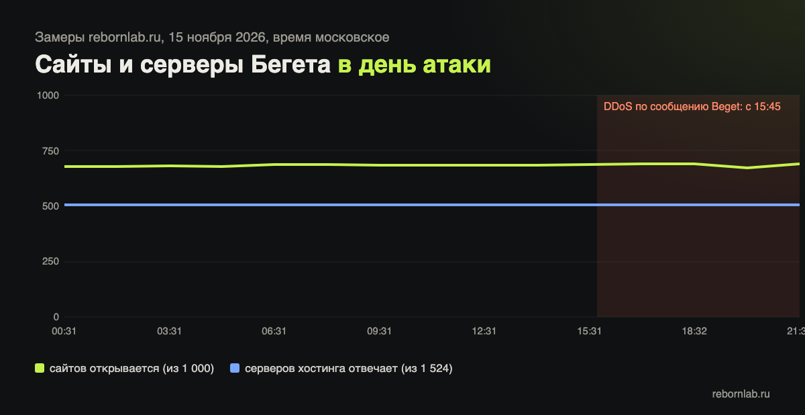
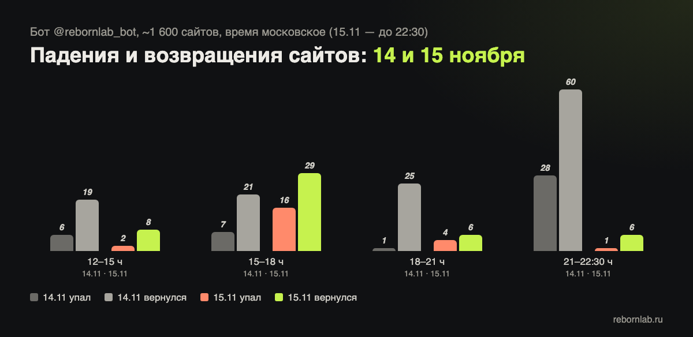

15 ноября в 15:45 по Москве Beget написал в [официальном канале](https://t.me/s/beget_official), что его инфраструктуру атакуют: DDoS до 850 Гбит/с, а к 17:00 — уже 2,1 Тбит/с. После [сбоя 2 ноября](/journal/beget-ne-rabotaet-kak-podnyali-sajt/) и почти двух недель восстановления это было последнее, что хотели услышать владельцы сайтов. Многие сразу пошли проверять, не упал ли их сайт снова.

У нас как раз есть чем ответить на этот вопрос не словами, а цифрами: бесплатный бот [@rebornlab_bot](https://t.me/rebornlab_bot) и страница [/beget/](/beget/) каждые 15 минут проверяют одни и те же 1 000 сайтов и 1 524 сервера виртуального хостинга Бегета. Посмотрели, что с ними было в день атаки.

Чтобы не путаться в цифрах: **выборка мониторинга — 1 000 сайтов и 1 524 сервера**, одни и те же каждый замер; **бот отслеживает ~1 600 сайтов** — те, что добавили сами владельцы. Это два разных измерения, ниже они идут отдельно.

*Статья обновляется: данные на 22:17 МСК 15 ноября 2026 года, день ещё не закончился.*

> **Коротко.** За время атаки (15:45–23:00 МСК) число открывающихся сайтов из нашей выборки держалось на уровне **686–692 из 1 000** — так же, как утром до неё. Серверов хостинга отвечало **500–507 из 1 524**, как и накануне. Небольшие «качели» были: с 15 до 18 часов бот поймал 16 падений сайтов против 7 в те же часы 14 ноября — и 29 возвращений за те же три часа. Связь серверов Бегета с внешними сервисами (о проблемах с Ozon, Wildberries и Сбербанком писал сам хостинг) наш замер не видит — подробно в разделе «Чего этот замер не видит» в конце статьи.

## Главные цифры

| Что | 15.11, 13:17 (до атаки) | 15.11, 17:47 (пик по словам Beget) | 15.11, 22:17 |
|---|---|---|---|
| Сайтов открывается (из 1 000) | **687** | **692** | **690** |
| Серверов хостинга отвечает (из 1 524 в 6 основных сетях) | **507** | **507** | **507** |
| Все отвечающие адреса Бегета (из 9 906) | **1 746** | **1 744** | **1 744** |
| VPS отвечает (из 1 601) | **150** | **150** | **152** |
| Сайтов переехало на другой хостинг | 138 | 142 | 143 |

Если коротко: линия ровная. Ни одного провала, похожего на [2–3 ноября](/journal/beget-ne-rabotaet-kak-podnyali-sajt/), когда за сутки исчезли почти все сайты.



## Падения и возвращения по часам

Бот следит за ~1 600 сайтами, которые добавили люди, и пишет два вида сообщений: «сайт перестал открываться» и «сайт снова работает». Сравнили их число 15 ноября с тем же временем 14-го:

| Часы (МСК) | 14.11: упал / вернулся | 15.11: упал / вернулся |
|---|---|---|
| 12:00–14:59 | 6 / 19 | 2 / 8 |
| 15:00–17:59 (начало атаки) | 7 / 21 | **16 / 29** |
| 18:00–20:59 | 1 / 25 | 4 / 6 |
| 21:00–23:59 | 28 / 60 | 1 / 6 — только 21:00–22:30, данные неполные |



С 15 до 18 часов падений стало вдвое больше, чем накануне, — 16 против 7. Это совпадает по времени с началом атаки, но на ~1 600 сайтов это около 1%, и возвращений в те же часы было больше, чем падений. Для сравнения: вечером 14 ноября, без всякой объявленной атаки, с 21:00 до 22:00 бот поймал 24 падения. Почему — мы не знаем и гадать не будем.

## Как мы считали

Всё считает одна служба на нашем сервере, без участия людей:

```
каждые 15 минут:
  1 000 сайтов на Бегете  → HTTP-запрос;
                             «открывается» = отдал страницу, а не ошибку или заглушку
  9 906 адресов Бегета    → проверка порта 80/443 (по реестру сетей Beget в RIPE)
  1 601 VPS (*.beget.app) → то же
```

Выборка — одни и те же 1 000 реальных сайтов на ~400 серверах Бегета (до 5 на сервер), а не тестовые адреса; сайт, переехавший к другому хостингу, в «открывается» не считается. На графике — каждый шестой замер (раз в полтора часа). Замер идёт с нашего сервера за рубежом, поэтому «открывается» значит «сервер Бегета отвечает в интернет», а не «открывается у конкретного провайдера». Падения в боте дополнительно перепроверяются из России — сайт, который открылся хоть откуда-то, упавшим не считается.

Цифры атаки (850 Гбит/с, 2,1 Тбит/с) и 215 000 восстановленных сайтов — данные самого Beget из [его канала](https://t.me/s/beget_official). Проверить их со стороны мы не можем и не пытаемся.

## Чего этот замер не видит

Честно о границах:

- **Связь «изнутри наружу».** Beget предупредил, что у части пользователей могли быть проблемы с доступом к Ozon, Wildberries, Сбербанку и другим ресурсам, а также обрывались FTP/SSH-сессии. Это про запросы *с серверов* Бегета наружу — например, когда сайт обращается к API оплаты или маркетплейса. Мы проверяем сайты снаружи и такую поломку не увидим. Если у вас перестала проходить оплата или выгрузка товаров — Beget просит создать тикет с темой DDOS и указать сервер, ресурс и описание проблемы.
- **Скорость.** Сайт, который открылся за 14 секунд, для нас «открывается». Замедление во время атаки мы не мерили.
- **Одна точка проверки.** Если у вашего провайдера проблема с маршрутом до Бегета, наш замер это пропустит. Проверить конкретный сайт можно на странице [мониторинга сайтов](/monitoring-saitov/) — там проверка идёт в том числе из России.
- **Сбой у нас.** 14 ноября в 22:20 один наш замер показал всего 347 серверов вместо 506 — через полтора часа всё вернулось. Скорее всего, это был сбой связи у нас, а не у Бегета, поэтому на графиках такие одиночные провалы мы не считаем событием.

## Что делать владельцу сайта на Бегете

1. Если сайт открывается — ничего срочного не нужно. Атака, судя по замерам, восстановленные сайты не уронила.
2. Если перестали работать оплата, выгрузка в маркетплейсы или почта через внешний сервис — это может быть следствием атаки; пишите в поддержку Бегета с темой DDOS.
3. Если сайт не вернулся с 2 ноября — проверьте его на [/beget/](/beget/): там видно, жив ли сервер и есть ли сайт в веб-архиве.

Чтобы не обновлять страницу вручную, добавьте сайт в бот [@rebornlab_bot](https://t.me/rebornlab_bot) — он бесплатный и напишет, если сайт упадёт или вернётся. Если статья пригодилась — перешлите её тому, кто тоже ждёт свой сайт.
