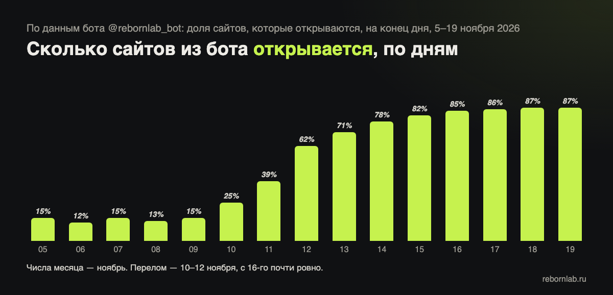

Мы каждый день наблюдаем за 1 442 сайтами через наш бесплатный бот @rebornlab_bot. 6 ноября из них открывался каждый восьмой. Сегодня, 19 ноября, открываются почти девять из десяти. Ниже собрали, что за эти две недели происходило у Бегета и других хостингов, наши цифры и практическую часть: что сделать с сайтом прямо сейчас.

> **Коротко.** У Бегета восстановление виртуального хостинга почти закончено, но в боте 182 сайта всё ещё не открываются, 145 из них дольше недели. Домены с Бегета снова можно переносить к другому регистратору. 17 ноября на полтора часа ложился Timeweb. Если ваш сайт вернулся, проверьте его по списку ниже: у части сайтов после восстановления сломаны файлы, планировщик задач или сертификат.

## Главные цифры на 19 ноября

| Что | Сколько |
|---|---|
| Сайтов под наблюдением бота | **1 442** |
| Из них на Бегете (по адресу сервера) | **1 194** |
| Открываются сейчас | **1 260 — 87%** |
| Не открываются | **182** |
| Из них не открываются дольше 7 дней | **145** |
| Переехали на другой хостинг, пока бот следил | **167** |
| 6 ноября открывалось | **12%** |

## Как возвращались сайты



Неделю, с 5 по 9 ноября, картина почти не менялась: открывались 12–15% сайтов. Перелом пришёлся на 10–12 ноября: за три дня доля выросла с 25% до 62%. Дальше прибавлялось всё медленнее, и с 16 ноября цифра стоит почти на месте: 85, 86, 87, 87%.

По дням это хорошо видно и в журнале бота. 12 ноября он отправил 464 сообщения «ваш сайт снова работает», 15 ноября 105, а 18 ноября 31. Возвращения не закончились, но превратились в единичные.

## Что известно про Бегет

Сбой начался в ночь на 1–2 ноября. 2 ноября компания сообщила о взломе управляющей системы и скриптах, которые удаляли данные ([Фонтанка, 16.11](https://www.fontanka.ru/2026/11/16/76768069/), [CNews, 16.11](https://cnews.ru/news/top/2026-11-16_obnulennyj_hakerami_rossijskij)).

Что изменилось за последнюю неделю, по сообщениям компании и публикациям:

- **15–16 ноября** — восстановлено больше 215 тысяч сайтов, восстановление виртуального хостинга «близится к завершению». В панель вернулись планировщик задач (Crontab) и раздел резервных копий. Работают 94% выделенных серверов ([Anti-Malware, 16.11](https://www.anti-malware.ru/news/2026-11-16-111332/52056)).
- **VPS** — бинарные резервные копии облачных серверов, по словам компании, потеряны полностью. Файловые копии получит примерно половина владельцев VPS (там же).
- **15 ноября** — DDoS-атака: сначала около 850 Гбит/с, потом до 2,1 Тбит/с. У части клиентов обрывались подключения по SSH и FTP. Наш замер этого дня по часам — в [отдельной новости](/journal/beget-ddos-15-noyabrya-zamery/).
- **Домены** — с 3 ноября аккредитация Бегета как регистратора приостановлена, но с 16 ноября он снова выдаёт коды AuthInfo, то есть домен можно перенести к другому регистратору ([Tproger, 16.11](https://tproger.ru/news/beget-vernul-perenos-domenov-ru-i-rf-akkreditaciya-poka-priost)). Как это сделать — ниже.
- **Оплата** — списания за услуги приостановлены ([Anti-Malware, 16.11](https://www.anti-malware.ru/news/2026-11-16-111332/52056)).

## Что у других хостингов

- **Timeweb, 17 ноября.** В 13:28 МСК компания объявила инцидент: не работали сайты, VPS и облако в России, Казахстане, Германии и Нидерландах. В 13:47 причиной назвали сетевое оборудование, в 15:05 инцидент закрыли. Вышло около полутора часов простоя. О потере данных не сообщалось ([StartPack](https://startpack.ru/article/timeweb-sboy)).
- **Selectel, 3 ноября** — сбой сети в одном из пулов. **ESTT, ночь на 8 ноября** — сбой клиентских серверов без объявленной причины ([Sostav, 9.11](https://www.sostav.ru/blogs/295933/119602)).
- **REG.RU, SpaceWeb, Hostland, Jino, Sprinthost** и остальные хостинги из нашего [мониторинга 27 хостингов](/hosting/) — массовых сбоев за неделю не было. У REG.RU в нашей выборке из 30 сайтов за неделю в среднем открывалось 95%, провалов не было.

## Если сайт до сих пор не открывается

182 сайта из бота всё ещё лежат, и у 145 это длится больше недели. Что мы бы сделали на месте владельца:

1. **Проверьте, включён ли сервер.** Пришлите в бот IP-адрес сервера — он скажет, отвечает ли сервер. Как найти IP — [в этой инструкции](/journal/beget-kak-proverit-server-sajta/). Если сервер включён, а сайт нет, проблема в самом аккаунте, и ждать «общего восстановления» уже бесполезно. Пишите в поддержку с конкретным адресом.
2. **Посмотрите, нет ли копии в панели.** Раздел резервных копий вернулся 15–16 ноября. Если копия есть, скачайте её себе, даже если сайт пока не восстановлен.
3. **Если копии нет и ждать нельзя,** сайт можно собрать из веб-архива. Мы разбирали это [на реальных замерах](/journal/sajt-na-begete-ne-vernulsya-vosstanovit-iz-arhiva/); бот по команде `/restore сайт.ru` бесплатно покажет, сколько страниц и картинок сохранилось.

## Если сайт вернулся, но работает странно

Свежие жалобы владельцев за 13–18 ноября ([Detector404](https://detector404.ru/beget), комментарии на Хабре) похожи друг на друга: сайт поднимается и снова падает, часть файлов повреждена, страницы грузятся медленно. Что проверить за 15 минут:

- **Ошибки на страницах.** Откройте не только главную, но и каталог, корзину, форму заявки. Ошибка 500 или «белый экран» на внутренних страницах обычно значит, что не восстановились отдельные файлы или стоит не та версия PHP. Четыре самых частых ошибки после восстановления мы [разобрали отдельно](/journal/beget-posle-vosstanovleniya-3-oshibki/).
- **Сертификат.** Откройте сайт с телефона по `https://`. Если браузер пишет «подключение не защищено», сертификат нужно перевыпустить в панели.
- **Планировщик задач (Crontab).** Он вернулся в панель только 15–16 ноября. Если на сайте были задачи по расписанию (выгрузка товаров, рассылки, резервные копии), проверьте, что они на месте и запускаются.
- **Формы и почта.** Отправьте себе заявку с сайта и проверьте, дошло ли письмо.
- **Пароли.** Если вы ещё не меняли пароли от панели, FTP и админки после атаки, вот [что и в каком порядке менять](/journal/beget-posle-ataki-paroli-proverka-sajta/).

## Как перенести домен с Бегета

Перенос домена к другому регистратору не трогает сам сайт: если не менять DNS-серверы, сайт продолжит открываться там же, где открывался.

1. **Посмотрите, до какого числа оплачен домен** (в панели или через whois). Если осталось меньше пары недель, сначала разберитесь с продлением: перенос может не успеть.
2. **Перепишите себе DNS-записи** домена: A, MX, TXT (SPF, DKIM). Они пригодятся, если на новом месте придётся их повторить.
3. **Получите код AuthInfo** в панели Бегета (раздел доменов) или через поддержку. С 16 ноября его снова выдают.
4. **Закажите перенос у нового регистратора**, указав домен и код. Цена и сроки у каждого регистратора свои, их лучше уточнить до заказа.
5. **После переноса проверьте**, что сайт и почта работают, а DNS-серверы остались прежними.

Если домен сейчас не нужно никуда переносить, не переносите. Перенос не защищает сайт, он только меняет место, где вы продлеваете домен.

## Что известно про компенсации

Официального объявления о компенсациях нет. Юристы AG Legal разобрали соглашение об уровне обслуживания (SLA) Бегета ([Хабр](https://habr.com/ru/companies/aglegal/articles/1109792/)): по их разбору, компенсация положена днями услуги, а не деньгами, её потолок — 30 дней, а заявление нужно подать в течение 30 дней после сбоя. DDoS-атаки из SLA исключены. Если планируете просить компенсацию, сохраните переписку с поддержкой и скриншоты с датами, пока они под рукой.

## Как мы считали

Бот проверяет каждый сайт, за которым его попросили следить: открывает главную страницу и смотрит, что вернулось. Перед сообщением «сайт упал» он перепроверяет сайт со второго сервера. Сайт считается «открывается», если страница загрузилась без ошибки сервера и это не заглушка хостинга. Смена состояния засчитывается только после двух одинаковых проверок подряд, чтобы мигание сети не превращалось в «упал, поднялся». С 16 ноября работающие сайты проверяются раз в 12 часов, неработающие раз в час.

Доля «открывается» на графике взята из последней точки каждого дня в статистике бота:

```
доля = сайтов_открывается / сайтов_под_наблюдением
5.11: 46 / 305 = 15%   ...   19.11: 1260 / 1442 = 87%
```

«На Бегете» значит, что адрес сервера сайта входит в сети Бегета (AS198610). «Переехал» значит, что сайт заработал, но уже на адресе другого хостинга.

## Что пошло не так и чего мы не видим

- **Timeweb мы не видим.** С 8 ноября Timeweb блокирует проверки нашего бота, поэтому сайты на нём мы сняли со слежения, и сбой 17 ноября в наших замерах не отразился. Цифры по нему взяты только из сообщений компании.
- **Выборка — не весь Бегет.** В боте сайты тех, кто сам пришёл и добавил адрес. Это больше тысячи сайтов, но не случайная выборка: сюда чаще попадали те, у кого сайт лежал.
- **Часть «лежащих» сайтов не вернётся никогда.** Владелец мог их забросить или перенести на другой домен. Отличить такой сайт от ещё не восстановленного по одной проверке нельзя.
- **Состав выборки менялся.** 6 ноября в боте было около 900 сайтов, 12 ноября почти 1 600, сейчас 1 442: люди добавляли и убирали сайты. Поэтому мы сравниваем доли, а не штуки.

## Что дальше

Бот продолжает следить и бесплатно напишет, когда ваш сайт упадёт или вернётся. Скоро он начнёт предупреждать и о том, что заканчивается сертификат или оплата домена. Про это обычно вспоминают, когда сайт уже не открывается. Добавить сайт — в [@rebornlab_bot](https://t.me/rebornlab_bot) или на странице [проверки сайта](/monitoring-saitov/).

Если сводка пригодилась, перешлите её тому, у кого сайт на Бегете.
