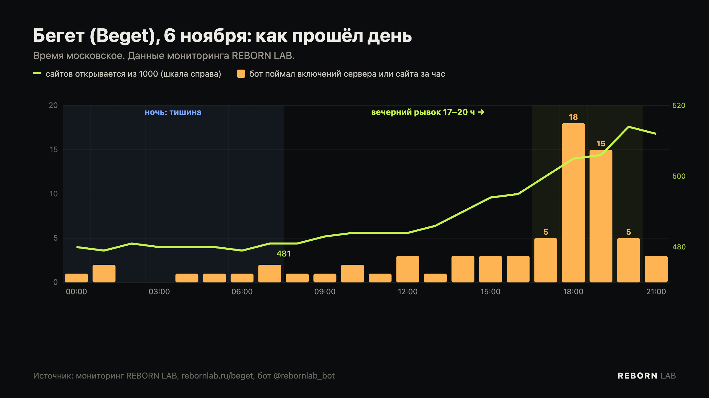

Пятый день восстановления Бегет (Beget) закончился лучше, чем начинался. Утром открывались 481 сайт из 1000, которые мы проверяем, вечером — **511**, это максимум за всё время наблюдений. Больше всего сайтов вернулось вечером: с 17 до 20 часов по Москве наш бот поймал больше 30 включений серверов и сайтов. Восстановление не встало — оно идёт медленно и рывками. Ниже — что мы увидели за день и как понять, стоит ли ждать именно вам.

## Как прошёл день

| Время (МСК) | Что происходило |
|---|---|
| 00:00–08:00 | Тишина: 480 → 481 сайт, ни одного нового сервера |
| 08:00–16:00 | Медленный рост: до 495 сайтов, по 1–4 в час |
| **17:00–20:00** | **Рывок: до 514 сайтов, бот поймал 18 включений в 18 часов и 15 — в 19** |
| 20:00–22:00 | Затихает |

В шести сетях, за которыми мы следим с начала, впервые с вечера 5 ноября прибавились серверы — было 276, стало 279. Во всех девяти сетях работают 557 серверов хостинга. Из 1601 облачного сервера (VPS) по-прежнему отвечает один.

**Главное наблюдение дня:** сайтов прибавилось на 30, а серверов — всего на 3. Значит, большая часть сайтов вернулась на **уже включённых серверах**. Бегет не только включает новые серверы, но и доводит до рабочего состояния сайты на тех, что уже работают. Если ваш сервер включён, а сайт ещё нет — шансы дождаться высокие.

## Что нового узнали сегодня

- **Бегет переносит аккаунты на новые серверы** и присылает письма «Ваш аккаунт перенесён на другой сервер». Если DNS домена не у Бегет, A-записи нужно поменять самому. Подробно — в новости [о переносе аккаунтов](/journal/beget-novye-servery-perenos-akkauntov/).
- **Хостинг Бегет работает не в шести сетях, а минимум в девяти** — в трёх «новых» сегодня отвечают около 280 серверов.
- **Резервные копии.** Панель, через которую клиенты получат свои копии, Бегет обещает примерно к 10 ноября; плату за недоступные сервисы не списывают. Что подготовить — в [отдельной новости](/journal/beget-rezervnye-kopii-panel/).
- **Почта работает, основная панель — нет.** Веб-почта webmail.beget.ru и почтовые серверы для программ отвечают, cp.beget.com — по-прежнему ошибка 502. [Подробнее](/journal/beget-pochta-i-panel-chto-rabotaet/).
- **Официальная хронология на beget.com не обновлялась с 5 ноября, 15:00.**

## Ждать или восстанавливать сайт самому

Как узнать адрес сервера и включён ли он — в [пошаговой инструкции](/journal/beget-kak-proverit-server-sajta/). Дальше — по таблице:

| Ваша ситуация | Совет |
|---|---|
| Сервер включён, сайт открывается с ошибкой 502 или ошибками базы | **Ждать.** Половина таких сайтов оживает за 2–3 часа. Больше суток — писать в поддержку |
| Пришло письмо о переносе аккаунта | **Действовать сразу:** если DNS не у Бегет — поменять A-записи на адрес из письма |
| Сервер в сетях 87.236.16.x, 5.101.152.x или 45.130.41.x с номером примерно до 100 | **Скорее всего, дождётесь.** В этих частях сетей включено больше всего серверов |
| Сервер в 45.130.41.x с номером выше 100 | **Ждать придётся дольше.** Там пока включены единицы. Если сайт приносит деньги — готовьте запасной вариант |
| Сервер в сетях 45.130.42.x или 45.130.43.x | **Готовьте запасной вариант.** Там не работает ни одного сервера |
| VPS на Бегет | **Не ждать.** Полных копий дисков нет, сервер придётся собирать заново |
| Есть своя свежая копия, а каждый день простоя стоит денег | **Поднимать сайт у другого хостинга уже сейчас** — аккаунт Бегет при этом не удаляйте |
| Своей копии нет, сайт важен | **Ждать копию от Бегет** (обещают примерно к 10 ноября) и тем временем поставить временную страницу с контактами |

## Что ждать на выходных

Это наше предположение, а не слова Бегет: по данным трёх дней, массовые включения проходят днём и вечером, ночью почти ничего не меняется. Будут ли инженеры так же работать в субботу и воскресенье — пока неизвестно; мы увидим это по графику и расскажем.

Если вы ждёте свой сайт — не проверяйте вручную по ночам. Бот [@rebornlab_bot](https://t.me/rebornlab_bot) проверяет его каждые 10 минут, круглосуточно и в выходные, и напишет сразу, как только включится сервер или откроется сайт. За 6 ноября он отправил людям 51 сообщение «сайт снова работает». Сейчас через него следят 526 человек — за 864 сайтами.

Живые графики восстановления — на странице [rebornlab.ru/beget](/beget/).
