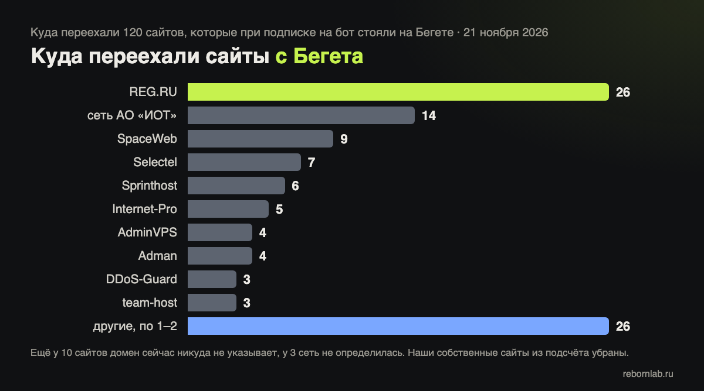

После ноябрьского сбоя в обсуждениях Бегета два вопроса повторяются чаще остальных: страшно ли оставаться и куда уходить, если уходить. Подборок «10 аналогов Beget» в интернете уже много. Мы решили посмотреть не на рейтинги, а на то, что владельцы сайтов сделали на самом деле.

В нашем бесплатном боте [@rebornlab_bot](https://t.me/rebornlab_bot) сейчас 1 438 сайтов. У 1 190 из них в момент подписки сервер был на Бегете. 21 ноября мы проверили, где каждый из них стоит сегодня.

> **Коротко.** Из 1 190 сайтов на Бегете остались 1 070, уехали 120 — каждый десятый. Больше всего уехавших сейчас на [REG.RU](/go/h-regru): 26 сайтов. Ещё 35 сайтов уезжали, а потом вернулись на Бегет. Переезд — не единственный способ перестать бояться: копия сайта вне хостинга и DNS отдельно от него защищают и тех, кто остаётся.

## Сколько уехало

| | Сайтов |
|---|---|
| Были на Бегете при подписке | 1 190 |
| Сейчас там же, на Бегете | 1 070 |
| Сейчас на другом хостинге | 120 |
| Уезжали, но сейчас снова на Бегете | 35 |

Большинство осталось. Многие ждали свой сайт больше недели, а когда он заработал, продолжили работать там же.

35 вернувшихся — это сайты, которые бот видел уехавшими, а сегодня они снова на серверах Бегета. Похоже, часть владельцев переносила сайт на время: подняли копию где-то ещё, дождались восстановления и вернулись. Своих причин эти люди нам не называли, так что это только наше предположение.

## Куда переехали 120 сайтов

| Хостинг или сеть | Сайтов |
|---|---|
| [REG.RU](/go/h-regru) | 26 |
| сеть АО «ИОТ» (AS29182) — дата-центр, хостинг по сети не определить | 14 |
| [SpaceWeb](/go/h-spaceweb) | 9 |
| Selectel | 7 |
| [Sprinthost](/go/h-sprinthost) | 6 |
| Internet-Pro | 5 |
| [AdminVPS](/go/h-adminvps) | 4 |
| Adman | 4 |
| DDoS-Guard | 3 |
| team-host | 3 |
| ещё два десятка хостингов, по 1–2 сайта | 26 |
| домен сейчас никуда не указывает | 10 |
| не определилось | 3 |

[REG.RU](/go/h-regru) выбрали 26 из 120 уехавших — больше, чем кого-либо ещё. На втором месте сеть, по которой хостинг не узнать: в ней стоят серверы нескольких компаний. Ссылки на хостинги в таблицах партнёрские: если купите хостинг по ним, мы получим вознаграждение. На цифры это не влияет, они из наших замеров. А рекомендуем мы только REG.RU — почему, ниже.



## Что показал наш мониторинг хостингов за неделю

Мы каждые 30 минут из России проверяем 27 хостингов: открывается ли панель управления, отвечают ли DNS-серверы, открываются ли случайные сайты их клиентов. Живой статус — на странице [хостингов](/hosting/). Вот неделя с 14 по 21 ноября, 336 замеров у каждого:

| Хостинг | Замеров со сбоем из 336 | Панель открывалась |
|---|---|---|
| [REG.RU](/go/h-regru) | 0 | 100% |
| [Sprinthost](/go/h-sprinthost) | 0 | 100% |
| Cloud.ru | 0 | 100% |
| [NetAngels](/go/h-netangels) | 1 | 99,7% |
| Masterhost | 1 | 100% |
| [Timeweb](/go/h-timeweb) | 1 | 100% |
| [SpaceWeb](/go/h-spaceweb) | 4 | 99,7% |
| Selectel | 10 | 100% |
| [AdminVPS](/go/h-adminvps) | 11 | 100% |
| HOSTKEY | 13 | 96,1% |
| [Fornex](/go/h-fornex) | 14 | 96,4% |

«Сбой» — это замер, в котором у хостинга не открылась панель, не ответила часть DNS-серверов или не открылась заметная доля сайтов из выборки. Неделя — короткий срок. Хороший результат за семь дней ничего не гарантирует на год вперёд.

## Почему мы советуем REG.RU

9 ноября мы сами перенесли rebornlab.ru и сайты наших клиентов на REG.RU. Прошло почти две недели, полёт нормальный, а в недельном замере у него ни одного сбоя. Хостинг и домены у одного провайдера, а это удобно, когда нужно быстро что-то поменять.

При этом REG.RU — не единственный хостинг без сбоев в нашей таблице. Мы рекомендуем его потому, что пользуемся им сами и готовы за него отвечать. Других не рекомендуем, пока сами не пройдём с ними путь от покупки до поддержки.

[Перейти на REG.RU](/go/h-regru). Ссылка партнёрская: если купите хостинг по ней, мы получим вознаграждение. На цифры в таблицах это не влияет — они из наших замеров.

Если решите переехать, но не хочется разбираться самим, поможем сделать всё под ключ: настроим хостинг или сервер на REG.RU и перенесём сайт с прежними адресами и без простоя. Пишите Николаю в Telegram — [@Reborn_Lab](https://t.me/Reborn_Lab).

## Страшно ли оставаться

Бояться стоит не хостинга, а ситуации, когда всё хранится в одном месте: сайт, единственная копия, DNS и почта. В ноябре хуже всего было тем, у кого копия лежала у того же хостинга, что и сайт: пока хостинг не работал, скачать её было нельзя.

Если остаётесь — сделайте три вещи, и следующий сбой станет задачей на вечер, а не катастрофой:

1. **Копия сайта вне хостинга.** Файлы и база — на компьютере и в облаке. На Бегете копию можно скачать в панели, раздел «BackUp». Для WordPress есть плагины, которые сами отправляют копию по расписанию.
2. **DNS отдельно от хостинга.** Тогда при сбое вы сами направите домен на другой сервер, а не будете ждать, пока поднимется панель.
3. **Слежение за сайтом.** Чтобы узнать о падении раньше клиентов. Бесплатно это делает наш бот: неработающий сайт он проверяет каждые 10 минут, работающий — раз в 3 часа.

Если уезжаете — те же три пункта нужны и на новом месте. Новый хостинг тоже может упасть.

## Что спрашивают перед переездом

**Что будет с доменом и оплатой Бегету?** Домен и хостинг — разные услуги. Сайт можно перенести, а домен оставить у Бегета: продлеваете его там же, а на новый сервер переключаете только DNS-записи. Хостинг на Бегете после переезда можно не продлевать. Удалять его сразу не стоит.

**Не потеряю ли место в поиске?** Если адреса страниц, заголовки и тексты остаются прежними, переезд поиск почти не замечает. Вредит долгий простой: робот несколько дней получает ошибки и начинает реже заходить на сайт.

**Что будет с почтой на домене?** Посмотрите, где она работает. Если почта на Бегете, её надо переносить отдельно и менять MX-записи. Если на Яндексе или Mail.ru, при переносе сайта эти записи просто не трогайте.

**Перенёс, а сайт не работает.** Чаще всего дело в мелочах. Версия PHP на новом хостинге не та, что была. Нет файла `.htaccess`. Пользователь базы данных не перенёсся вместе с базой — его надо создать заново и дать ему права. Или в базе WordPress остались старые адреса.

**Когда выключать старый хостинг?** Не в день переезда. Новый адрес у всех посетителей обновляется не сразу, иногда до суток. Держите старый сайт работающим, пока не убедитесь, что новый открывается у всех и заявки приходят.

## Как мы считали

Для каждого сайта из бота мы взяли его текущий IP-адрес и узнали, какой сети он принадлежит — по открытым данным реестра RIPE. У Бегета своя сеть, AS198610. Сайт, который при подписке был на Бегете, а сейчас в другой сети, считаем уехавшим.

```
домен → IP (dig A) → номер сети (whois.cymru.com) → AS198610 = Бегет
```

Мониторинг хостингов — наша служба: каждые 30 минут из России, панель, DNS и выборка сайтов клиентов у каждого хостинга.

## Чего эти цифры не показывают

- **Это не все клиенты Бегета.** В бот приходят люди, у которых сайт не открывался. Это не случайная выборка.
- **Сеть — не всегда хостинг.** Некоторые компании арендуют место у чужих дата-центров, поэтому 14 сайтов в сети АО «ИОТ» мы не смогли отнести к конкретному хостингу. Сайт за Cloudflare вообще не показывает, где стоит.
- **Мы не знаем причин.** Почему человек уехал или вернулся, мы не спрашивали. Видим только, где сайт стоит сейчас.
- **Свои сайты мы исключили.** rebornlab.ru и сайты наших клиентов стоят на REG.RU, мы их убрали из подсчёта, чтобы не накрутить ему цифру.

## Если сомневаетесь

Пришлите адрес сайта боту [@rebornlab_bot](https://t.me/rebornlab_bot) — он скажет, где сайт стоит сейчас, и будет за ним следить. Статус хостингов из России — на [rebornlab.ru/hosting](/hosting/). Если нужен переезд без простоя и с сохранением адресов, напишите Николаю в Telegram [@Reborn_Lab](https://t.me/Reborn_Lab).
