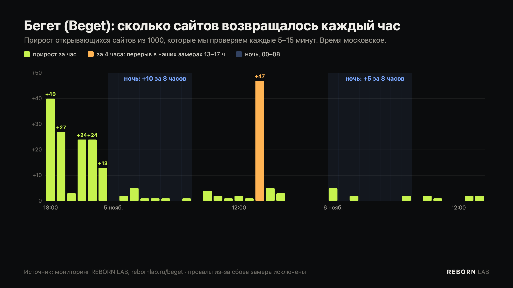

Почасовые данные нашего мониторинга показывают, что Бегет (Beget) возвращает сайты не равномерно, а рывками, и в основном днём и вечером. Вечером 4 ноября открылся 131 сайт из 1000, которые мы проверяем. За ночь на 5 ноября — 10. Днём 5 ноября — 65, причём 47 из них за четыре часа около 15:00. А за всю ночь на 6 ноября — всего 5 сайтов.

## Цифры по часам

Мы считаем, сколько сайтов из нашей выборки открывается в конце каждого часа. Короткие провалы, когда сбоил сам замер, а не Бегет, исключены — они видны как падение и возврат ровно на те же значения через час.

| Период (МСК) | Сайтов вернулось | Серверов хостинга включилось |
|---|---|---|
| 4 ноября, 17:00–24:00 | **+131** | +67 |
| ночь на 5 ноября, 00:00–08:00 | +10 | +26 |
| 5 ноября, 08:00–24:00 | **+65** | +13 |
| — из них 13:00–17:00 | +47 | +8 |
| ночь на 6 ноября, 00:00–08:00 | **+5** | 0 |
| 6 ноября, 08:00–14:00 | +7 | 0 |

Серверы здесь — в шести сетях Бегет, за которыми мы следим с самого начала. С 17:00 5 ноября их число не меняется: работают 276.

## Что из этого видно

**Ночью почти ничего не меняется.** Обе ночи прирост — единицы сайтов за восемь часов. Похоже, массовые включения проходят в рабочее время, когда рядом есть люди, которые могут проверить результат.

**Работа идёт пачками.** Самый большой рывок 5 ноября пришёлся на 13:00–17:00: +47 сайтов. Наш бот мониторинга в это же время поймал 13 включений серверов за один час — около 14:00. А в 15:00 Бегет опубликовал официальное «восстановлено 60% виртуального хостинга». В остальные часы — по 1–4 сайта.

**«Ночью тишина» не значит, что ничего не делают.** Утром 6 ноября мы нашли, что часть аккаунтов Бегет переносит на новые серверы в других сетях и присылает клиентам письма о переносе. В трёх таких сетях уже работают около 280 серверов хостинга. За ними мы следим только с 6 ноября, поэтому ночную работу там пока не видно. Вполне возможно, что ночью восстанавливают аккаунты из резервных копий на новые серверы, а старые серверы остаются выключенными. Подробно о переносе — в новости [«Бегет переносит аккаунты на новые серверы»](/journal/beget-novye-servery-perenos-akkauntov/).

Сам Бегет режим работ не публикует: в официальной хронологии на beget.com последнее обновление от 5 ноября, 15:00.

## Что это значит для владельца сайта

- **Скорее всего, новости придут днём.** Если сайт не вернулся вечером, ночью он вряд ли откроется — ждите следующего дня.
- **Смотрите почту в рабочее время.** Письма о переносе аккаунта на другой сервер приходили утром. Если DNS домена не у Бегет, после такого письма нужно поменять A-записи — иначе сайт не откроется даже после включения нового сервера.
- **Не проверяйте вручную.** Бот [@rebornlab_bot](https://t.me/rebornlab_bot) проверяет ваш сайт каждые 10 минут, днём и ночью, и напишет сразу, как только включится сервер или откроется сайт.

Мы продолжаем наблюдать, теперь по девяти сетям Бегет. После ночи на 7 ноября будет видно, идёт ли ночью работа на новых серверах. Живые графики — на странице [rebornlab.ru/beget](/beget/).
