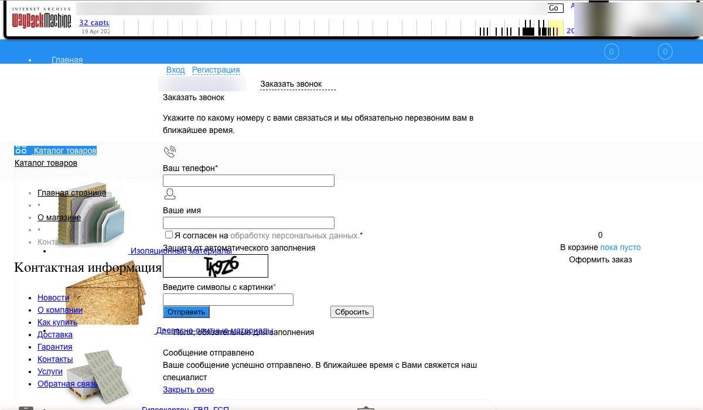

Веб-архив обычно хорошо сохраняет тексты, заголовки и адреса страниц. С картинками и оформлением результат непредсказуем, а базу данных, заказы и админку он не хранит совсем. Поэтому большое число страниц в архиве ещё не значит, что сайт удастся вернуть целиком.

За последние дни мы разобрали десятки сайтов, которые их владельцы хотели восстановить. Ниже цифры по нескольким из них, названия убрали.

## Что мы посчитали

Считали адреса, которые архив сохранил как рабочие. Период у сайтов разный: где-то всё время существования, где-то последние один-два года.

| Сайт | Страниц | Картинок | Что важно |
|---|---|---|---|
| Сайт услуг | 2 основные | 66 | Сохранился почти полностью |
| Компания с каталогом | около 310 | около 295 | Картинок примерно по одной на страницу |
| Магазин автотоваров | около 2 700 | 161 | Одна картинка примерно на 17 страниц |
| Магазин стройматериалов | около 4 800 | около 1 550 | Ещё 228 PDF-файлов |
| Портал со статьями | около 7 500 | больше 10 000 | Почти всё — статьи |

Самая показательная строка — магазин автотоваров. Описания 2 600 товаров сохранились, а большинства их фотографий в архиве нет. По числу страниц сайт выглядит отлично, но витрину без фото покупателям не покажешь.

## Что архив обычно сохраняет хорошо

- Тексты страниц и заголовки.
- Адреса страниц и структуру разделов. Для поиска это особенно важно.
- Меню и общий вид главной страницы.
- Часть документов: прайсы и инструкции в PDF.

## Где начинаются потери

**Картинки.** Архив сохраняет их отдельно от страниц, поэтому страница может быть, а её фото нет. Обычно лучше всего сохраняются картинки с главной и из популярных разделов.

**Оформление.** У магазина стройматериалов восемь файлов стилей не скачались с первого раза, и страница буквально рассыпалась: меню превратилось в список, а всплывающее окно оказалось посреди экрана. Файлы пришлось доставать повторно и искать в снимках за другие даты. Если какого-то файла нет совсем, его приходится писать заново.

**Актуальность.** Страницы сохраняются в разное время. Одна карточка товара может быть июльской, другая — двухлетней давности, вместе с ценой.

**Лишнее.** В том же магазине нашлось 238 адресов со статьями о драйверах за 2010 год. К магазину они отношения не имеют. Если считать только общее число страниц, такой мусор завышает объём.

## Как это выглядит в самом архиве

Многие, открыв свой сайт в архиве, решают, что восстанавливать нечего: вместо дизайна там сплошное полотно. Меню превратилось в список, картинки наехали на текст, а всплывающая форма стоит посреди страницы.

Такой вид ещё ничего не значит. Обычно архив просто не отдал часть файлов оформления, а тексты на месте, и многие картинки тоже. Прежний вид часто можно вернуть: нужные стили находятся в других снимках, а недостающие пишутся заново.

Бывает и наоборот: страница выглядит почти как живая.

Но и хороший вид главной не гарантирует, что так же сохранились внутренние страницы. Поэтому смотреть надо не одну страницу, а несколько.

## Чего в архиве нет

- Базы данных: заказов, клиентов, заявок.
- Личных кабинетов и пользователей.
- Админки сайта.
- Всего, что работает на сервере: отправки форм, поиска, корзины, оплаты.

Внешний вид этих функций архив может показать, но нажатие на кнопку ни к чему не приведёт. Формы и поиск приходится настраивать заново. Если вам важны заказы или кабинеты, нужна копия с базой данных. Веб-архив её не заменит.

## Как проверить свой сайт

1. Откройте [web.archive.org](https://web.archive.org/) и введите адрес сайта.
2. Посмотрите в календаре, когда был последний снимок.
3. Откройте не только главную, но и три-четыре внутренние страницы, например карточки товаров.
4. Проверьте, видны ли на них картинки и работает ли оформление.

Быстрый подсчёт страниц и картинок можно сделать на нашей странице [«Можно ли восстановить сайт»](/beget/vosstanovit/). Проверка бесплатная. Сам архив иногда перегружен или временно недоступен, тогда нужно немного подождать.

## Что может восполнить пробелы

- Ваши фотографии, прайсы и старые файлы, в том числе на компьютере, в почте и у подрядчиков.
- Материалы производителей и поставщиков, если они разрешают их использовать.
- Яндекс Картинки. Там иногда находятся копии с вашего сайта. В одном проекте их пришлось использовать как временную замену, потому что других фотографий не было. Точно под конкретный товар они подходят не всегда.

## Коротко

Веб-архив хорошо подходит, чтобы вернуть содержимое и структуру сайта. Но прежде чем рассчитывать на него, посмотрите не на общее число страниц, а на картинки, свежесть снимков и то, какие функции нужны сайту. Если разобраться самостоятельно не получается, [напишите нам](/contact/): посмотрим, что сохранилось именно у вас.
