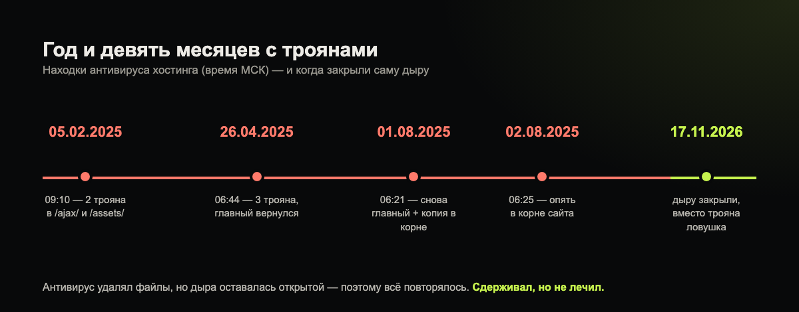
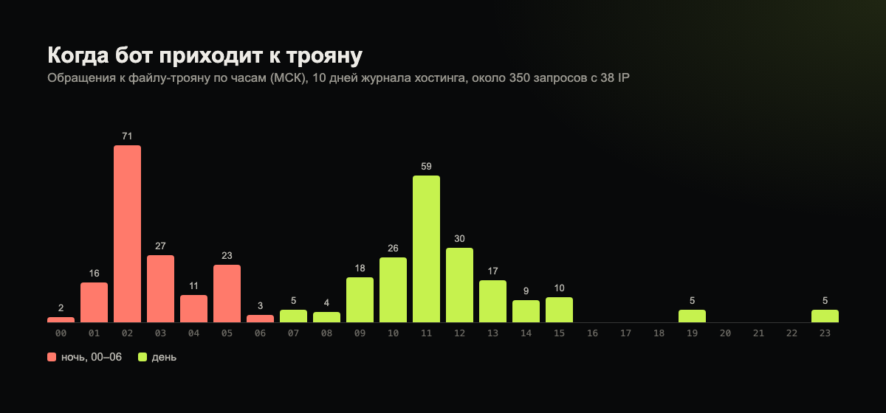
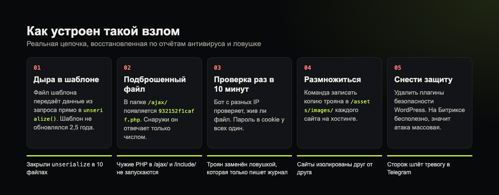
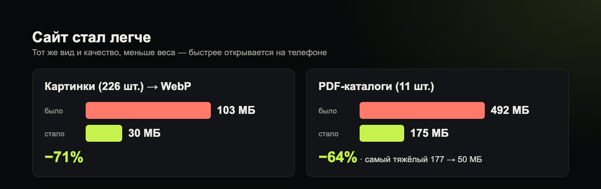
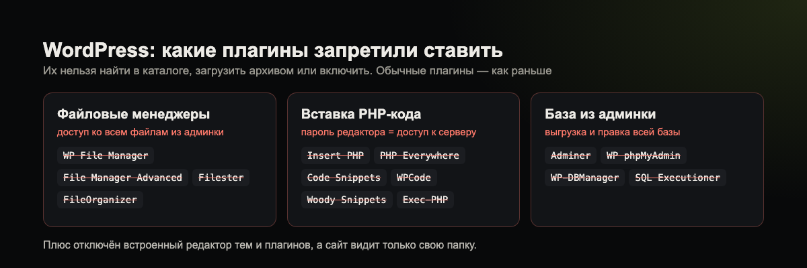
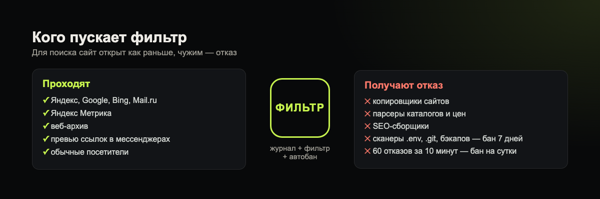

Для одного клиента мы восстановили сайт на 33 325 товаров: с нуля на 1С-Битриксе, из веб-архива и клона старого сайта. Запустили его на хостинге заказчика, а потом разобрали два соседних сайта на том же хостинге. По дороге нашли троян, которому бот приходил по расписанию, служебный файл, который пускал в админку без пароля, рассылку спама от имени домена и ещё десяток мелочей. Рассказываю, что именно нашли, как закрыли и что из этого можно проверить у себя без программиста.

> **Коротко.** Сайты открывались, заявки приходили, снаружи всё выглядело нормально. А клиент жил с этим с февраля 2025 года, год и девять месяцев: ночью на сайт подбрасывали трояны, утром антивирус хостинга находил их снова. Внутри был троян, который бот проверял каждые 10–12 минут, дыра в шаблоне, через которую его подбрасывали, и файл, пускавший любого в админку без пароля. Закрыли всё, поставили сторожа с уведомлениями в Telegram, а в конце статьи — 10 проверок, которые стоит сделать у себя.

## С чего началось

Клиент — промышленная компания с тремя сайтами. Задача: восстановить основной сайт с нуля на 1С-Битриксе. Источники — веб-архив и клон старого сайта: из них собрали страницы, товары, тексты и картинки, а сам Битрикс с шаблоном, каталогом и формами настроили заново.

Каталог получился на 33 325 товаров, у 32 420 есть фото. Адреса, заголовки и описания старых страниц сохранили один в один, чтобы не потерять позиции в поиске. Когда сайт запустили на хостинге клиента, сверили 256 случайных страниц старой и новой версии: заголовки, описания, H1, canonical, ссылки. Расхождений ноль.

Пока смотрели хостинг, клиент попросил заодно глянуть два соседних сайта. С этого и началась основная история.

## Что нашли на хостинге

| Что | Сколько | Чем грозило |
|---|---|---|
| Обращения бота к «чёрному ходу» | 332 за 10 дней, 38 IP | бот проверял, жив ли троян, и присылал команды |
| Трояны, которые удалял антивирус хостинга | 5 файлов трёх видов | возвращались после удаления, 2025 год |
| Уязвимость в шаблоне | 10 файлов | через неё подбрасывали трояны |
| Вход в админку без пароля | 1 файл | любой, кто знал адрес, становился администратором |
| Открытый парсер с выгрузкой базы | 1 папка | скачивался кусок базы, ошибки показывали пути сервера |
| Фальшивые подписки на рассылку | 973 | сайт слал письма на чужие адреса от имени домена |
| Тестовая копия основного сайта | 2,9 ГБ | ещё одна точка входа, которую никто не обновлял |
| Администраторы, не заходившие больше полугода | 3 | лишние учётки с полными правами |

> **Посетитель ничего из этого не видел.** Страницы открывались, заявки приходили. Всё происходило внутри.

Отдельно про пароли. Пароль базы данных хранится в файле настроек сайта, а троян с доступом к файлам мог его прочитать. При этом у хостинга есть phpMyAdmin, открытый из интернета: с паролем от базы туда можно зайти откуда угодно. Пароль сменили.

## Как работал троян

Самое интересное. В журналах антивируса хостинга нашлась история: в феврале, апреле и августе 2025 года он находил и удалял трояны. Всего пять файлов трёх видов, почти все в папке `/ajax/`. Главный назывался `932152f1caff.php`: антивирус убирал его четыре раза, а он появлялся снова.

Судя по времени отчётов, это выглядело так. 5 февраля в 09:10, 26 апреля в 06:44, 1 августа в 06:21, 2 августа в 06:25 по Москве антивирус находил на сайте свежие трояны. Их подбрасывали ночью, а утром сайт уже был заражён.

Клиент боролся с этим год и девять месяцев, с февраля 2025-го по ноябрь 2026-го, и безрезультатно: удаляешь файлы, а через несколько недель они снова на месте. Держался сайт только благодаря антивирусу хостинга.

> **Антивирус трояны сдерживал, а не лечил.** Он убирал файлы, а дыра, через которую их подбрасывали, оставалась открытой. Поэтому каждый раз всё начиналось заново.



В журналах веб-сервера за последние 10 дней к этому файлу пришло 332 запроса с 38 разных IP. Мы удалили файл, а на его месте поставили ловушку.

> **Ловушка вместо трояна.** Она ничего не выполняет, отвечает боту так же, как троян, и записывает всё, что ей присылают. Так мы увидели, кто приходит и что хочет сделать.



За одну ночь ловушка поймала 21 обращение с пяти IP. Это программа, а не человек:

- запрос «живой ли файл» и команда приходят в одну и ту же секунду;
- заходы идут ровно раз в 10–12 минут;
- с одного IP каждый раз «новый браузер»: Windows XP с Internet Explorer 8, Chrome 49, Firefox 49 — такими никто не пользуется лет десять;
- у всех IP один и тот же пароль в cookie, значит, ими управляет один оператор.

Команды приходят в base64. Мы их расшифровали, но не выполняли. Их три: «ты живой?», «запиши свою копию в папку `/assets/images/` каждого сайта на этом хостинге» и «удали плагины безопасности WordPress». Последняя на Битриксе бесполезна, то есть атака массовая: бот стучится во все сайты подряд и не разбирает, на чём они сделаны.



## Через что заходили

Дыра оказалась в шаблоне сайта, который не обновлялся с апреля 2023 года. Файл `include/mainpage/comp_catalog_ajax.php` брал данные прямо из запроса посетителя и передавал их в функцию `unserialize()`. Для PHP это классика: подсунул специально собранную строку — получил возможность выполнять свой код.

Сейчас такие запросы ловила проактивная защита Битрикса и отвечала 403, но сама дыра никуда не делась. Такие же вызовы нашлись ещё в девяти файлах корзины и быстрой покупки.

> **Дыра была не в Битриксе, а в шаблоне.** Шаблон не обновляли 2,5 года — через него и заходили.

## Что сделали

**Безопасность.**

- Закрыли `unserialize()` во всех 10 файлах: теперь функция не создаёт объекты из присланных данных.
- В папках `/ajax/` и `/include/` из интернета открываются только рабочие файлы сайта по списку. Подброшенный файл не запустится, даже если его снова удастся записать.
- Закрыли из интернета служебную папку `/local/`. Там лежали вход без пароля, парсер, журналы мониторинга и тестовые скрипты.
- Каждый сайт на хостинге теперь видит только свою папку. Взлом одного больше не даёт доступа к файлам и паролям баз соседних.
- В админке включили журнал входов, капчу после трёх неверных паролей и выход через 30 минут бездействия. Трёх давно не заходивших администраторов отключили.
- Убрали лишний SSH-ключ и сменили пароль базы.

**Спам без капчи.** Боты отправляли форму подписки, не открывая страницу как браузер: скачивали HTML, находили форму и сразу слали. Мы добавили скрытую метку, которую ставит скрипт в браузере. У человека она есть всегда, у такого бота её нет. 973 фальшивые подписки выключили, письма на чужие адреса прекратились.

**Парсинг.** Копировщики сайтов, HTTP-библиотеки и SEO-краулеры получают 403. Чаще 90 страниц в минуту с одного адреса — «подождите минуту». Яндекс, Google, веб-архив и превью мессенджеров проходят всегда.

**SEO.**

- Нашли заглушку «Название компании» в заголовке каталога и опечатку в заголовке главной.
- В описаниях трёх разделов висела черновая вставка «Аналог [добавить соответствующую модель через запятую]». Её видели все, кто находил эти страницы в поиске.
- Карта сайта для людей показывала разделы соседнего сайта: 44 ссылки вели на 404.
- В sitemap.xml было 29 старых адресов с переадресацией.
- В карточках товаров стояла разметка рейтинга «5 из 5, 1 отзыв» без единого реального отзыва.

Всё исправили, на всех страницах поставили canonical, описали 44 товара, у которых не было текста.

**Скорость.** 226 тяжёлых картинок перевели в WebP: было 103 МБ, стало 30 МБ. PDF-каталоги сжали с 492 до 175 МБ. Самый тяжёлый весил 177 МБ, после сжатия 50.



**Бэкапы.** Копия каждую ночь уходит с хостинга клиента на наш сервер, а оттуда в облако. Качается только изменённое: если на сайте ничего не поменялось, новая копия не создаётся. Храним четыре последние.

**Сторож.** Каждые 10 минут проверяем новые и изменённые скрипты на всех сайтах хостинга, подозрительный код в них, изменения в списке администраторов и вспышки неверных паролей. Если что-то нашлось, сообщение приходит в Telegram. Ловушка отчитывается одной сводкой утром.

## Как мы проверяли

Поиск подброшенных файлов начинается с простого: скрипт с именем из случайных букв и цифр в папке, где таких быть не должно.

```
find ~/www -type f -regextype posix-extended \
  -regex ".*/[0-9a-f]{8,}\.php" -not -path "*/cache/*"
```

Опасные места в коде — где данные посетителя без проверки попадают в `unserialize()`, `eval()` или в запуск команд:

```
grep -rlE "unserialize\s*\(\s*(urldecode\s*\()?\\\$_(POST|GET|REQUEST)" \
  --include=*.php include/ ajax/ local/
```

Защиту проверяли не на слово. Запрос как у бота (без скриптов страницы) должен отсекаться, служебные файлы — отдавать 403, рабочие — 200. Форму «Заказать звонок» проверили в настоящем Chrome на искусственно медленной сети: раньше клик до полной загрузки страницы просто терялся, теперь сразу появляется окно «Открываем форму…».

## Что пошло не так

- **Ошибся в отчёте.** В первом аудите я написал, что на одном сайте нет Яндекс Метрики. При первой проверке страница пришла без счётчика, и я не перепроверил. Метрика там была. Исправили отчёт и нашли настоящую проблему: цели второго сайта уходили в чужой счётчик, и его заявки в Метрике не считались.
- **Тестовое письмо дошло до клиента.** Проверяя, что живой человек может подписаться, я отправил подписку на несуществующий адрес. Сайт отправил письмо «подтвердите подписку», а возврат «не доставлено» пришёл клиенту на почту. Теперь формы с письмами проверяем только по журналам.
- **Историю не восстановить целиком.** Хостинг хранит журналы посещений около 10 дней, журнал входов Битрикса до нас почти не вёлся. Когда троян появился впервые и откуда, установить нельзя. Все журналы, что были, сохранили.

## Не только Битрикс: WordPress и Webasyst

Дыры бывают в любой CMS, и чаще всего не в самом движке, а в том, что на него поставили за годы работы. Два примера из наших восстановлений этого месяца.

**WordPress.** Один сайт мы восстанавливали с оригинальных файлов и базы. WordPress 5.9, старый Elementor, 16 выключенных плагинов на 150 МБ. Что было опасным:

- Плагин Insert PHP был включён. Он позволяет вставить PHP-код прямо в страницу из админки. Кто получил пароль редактора, тот получил сервер.
- Среди выключенных лежал WP File Manager — файловый менеджер в админке. Выключенный плагин всё равно остаётся на диске, а в старых версиях этого плагина были дыры, через которые заливали файлы без входа.
- 770 файлов, присланных посетителями через форму (202 МБ), открывались по прямой ссылке любому, кто её угадал.

> **Выключенный плагин всё равно лежит на диске.** Если в нём дыра, ей не важно, включён он или нет. Не нужен — удаляйте.

Insert PHP и все выключенные плагины удалили. Эти файлы теперь видят только вошедшие в админку. Встроенный редактор тем и плагинов в админке отключили. А ещё запретили саму установку опасных плагинов: их нельзя найти в каталоге, загрузить архивом или включить. В списке три группы:

- файловые менеджеры: WP File Manager, File Manager Advanced, Filester, FileOrganizer;
- вставка и выполнение PHP: Insert PHP, PHP Everywhere, Code Snippets, WPCode, Woody Code Snippets, Exec-PHP, Shortcoder, Header Footer Code Manager;
- доступ к базе из админки: Adminer, WP phpMyAdmin, WP-DBManager, SQL Executioner.

Обычные плагины ставятся как раньше. Сайт работает на отдельном PHP и видит только свою папку.



**Webasyst.** Интернет-магазин на Shop-Script восстанавливали из веб-архива. Файлы движка поставили с нуля.

> **Со старого хостинга не взяли ни одного PHP-файла.** Так чужой код не переезжает вместе с сайтом.

 Убрали приложения, которые магазину не нужны, в том числе PHP-консоль разработчика. Это тот же Insert PHP, только для Webasyst. PHP теперь выполняется только в трёх рабочих файлах движка, любой другой `.php` отдаёт 404.

Проверка случилась быстро. Через час после выпуска сертификата для второго домена магазина пришёл сканер: он нашёл адрес в открытом журнале сертификатов. За две минуты он сделал 2 021 запрос — искал `.env`, `.git`, ключи, бэкапы, файлы WordPress. Получил только главную страницу, остальное 403 и 404. Теперь такие сканеры блокируются автоматически на неделю.

**Журнал и фильтр ботов.** Это мы теперь ставим почти на все сайты, которые ведём, независимо от CMS. Без журнала посещений не узнать, кто и что делал на сайте: в нашем кейсе всю историю атаки восстановили именно по нему. Поэтому журнал включён всегда и хранится отдельно для каждого сайта.

> **Без журнала атаку не разобрать.** Он должен быть включён всегда, а не «когда что-то случится».

Вторая часть — фильтр. Яндекс, Google, Bing, Mail.ru, веб-архив, Метрика и превью ссылок в мессенджерах проходят без ограничений: для поиска сайт открыт как раньше. Всем остальным приходится несладко. Программы-копировщики, парсеры каталогов, SEO-сборщики, сканеры уязвимостей и запросы без браузера получают отказ. Кто слишком часто листает страницы, получает паузу. Кто ищет `.env`, `.git`, бэкапы и `phpinfo`, попадает в бан на неделю, кто набрал больше 60 отказов за 10 минут — на сутки. Скачать сайт целиком или выгрузить каталог себе простой программой больше не выйдет.



## 10 проверок, которые стоит сделать у себя

Особенно если сайт переезжал после сбоя хостинга или его делали разные подрядчики.

1. **Копия не на том же хостинге.** Сайт и база должны лежать ещё где-то: другой сервер, облако, хотя бы компьютер. Копия в панели того же хостинга пропадёт вместе с ним.
2. **Нет ли PHP в папке загрузок.** В `upload/`, `wp-content/uploads/`, `images/` скриптов быть не должно. Нашли `.php` — это повод разбираться.
3. **Файлы со странными именами.** Скрипт из случайных букв и цифр в корне сайта или в `ajax/` — почти всегда чужой.
4. **Список администраторов.** Все ли эти люди ещё работают с сайтом? Лишних отключить.
5. **Пароли после смены подрядчика.** Панель хостинга, база данных, FTP и SSH, админка. Отдельно — чужие SSH-ключи в `.ssh/authorized_keys`.
6. **Служебное в корне сайта.** Архивы `.zip` и `.tar.gz`, дампы `.sql`, файлы вроде `test.php`, `info.php`, `enter.php`. Убрать или закрыть.
7. **Обновления движка и шаблона.** Шаблон, который не обновлялся пару лет, — частая причина взлома, даже если сам движок свежий.
8. **Журнал входов и лимит попыток.** В Битриксе это «Проактивная защита» и политика безопасности группы администраторов, в WordPress — плагин ограничения попыток входа.
9. **Формы от ботов.** Если на почту сыплются «подтвердите подписку» или возвраты «не доставлено» — форму используют для спама. Помогает скрытая метка, которую ставит скрипт в браузере. Капча не обязательна.
10. **Журнал посещений включён и вы в него смотрите.** На некоторых хостингах он выключен или хранится пару дней. Посмотрите, что запрашивают ночью. Повторяющиеся обращения к одному и тому же странному файлу — плохой знак.

## Если нужна помощь

Мониторинг сайтов в нашем боте [@rebornlab_bot](https://t.me/rebornlab_bot) бесплатный: пришлите адрес, и он напишет, если сайт перестанет открываться. Если хотите, чтобы мы посмотрели ваш сервер так же, как в этом кейсе, напишите — [контакты здесь](/contact/).
