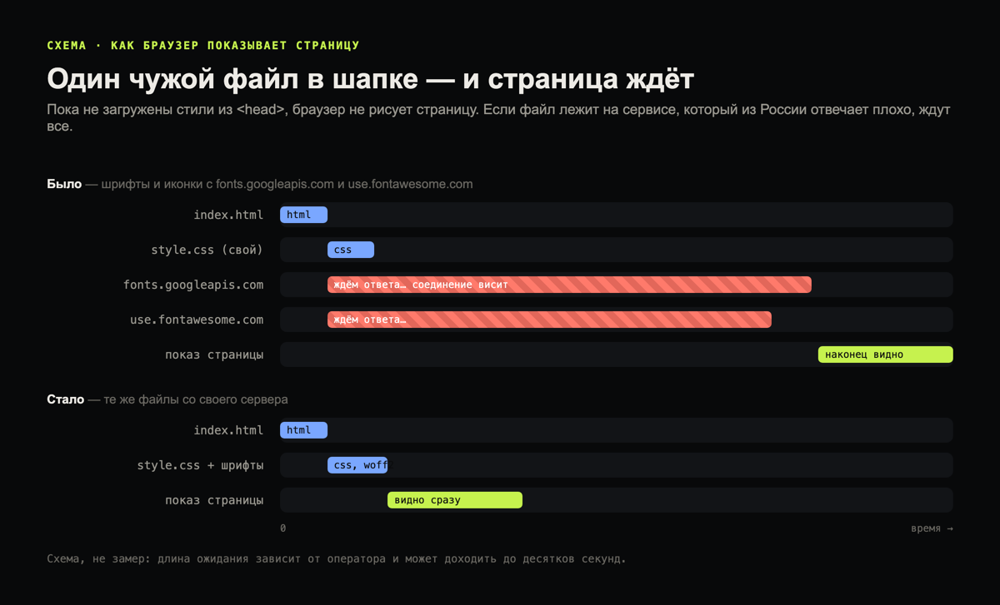
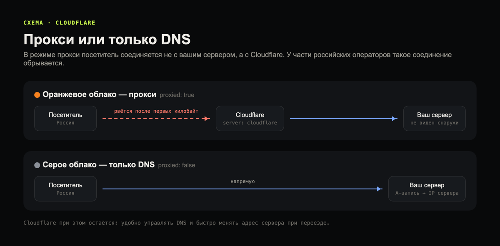
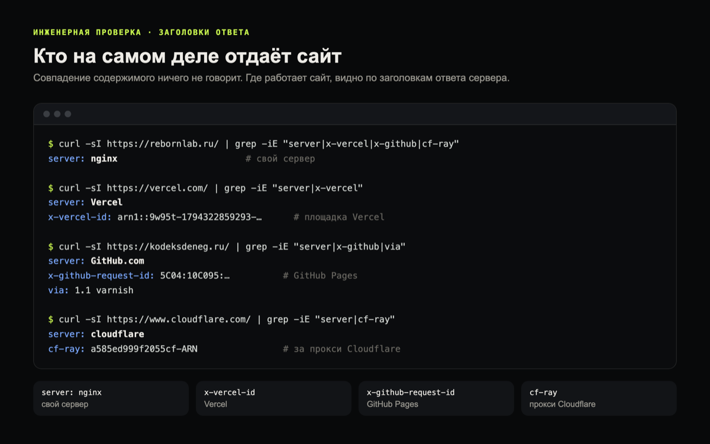
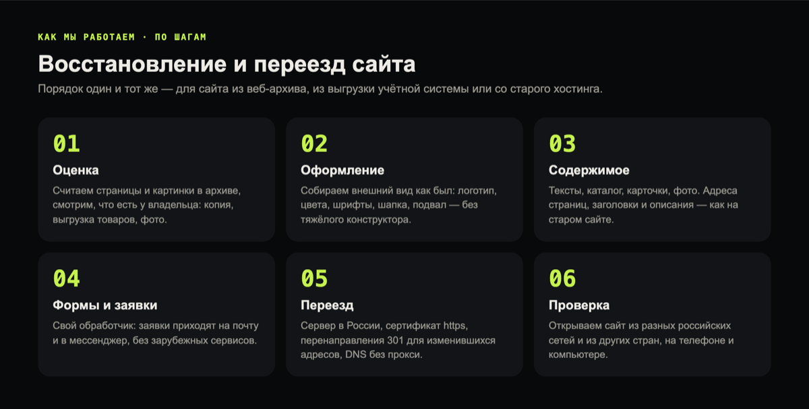

Сайт может открываться у вас и не открываться у клиента: у одного висит белый экран, у другого нет видео, у третьего с включённым VPN ничего не грузится. Почти всегда причина одна из десятка. Её можно найти и устранить без смены дизайна. Ниже — то, на что мы сами наткнулись, когда переносили сайты клиентов, и как это исправляли.

## Как сайт может «не открываться»

Это три разные проблемы, и лечатся они по-разному:

1. **Не открывается совсем** — ошибка соединения или бесконечная загрузка.
2. **Открывается, но висит или выглядит сломанным** — белый экран, нет шрифтов и иконок, не работают кнопки и формы.
3. **Не открывается у части людей** — у одного оператора, только без VPN или наоборот только с VPN.

Чаще всего встречается второй вариант, и его проще всего не заметить: у владельца сайт работает, потому что браузер давно всё закешировал.

## Причина 1. Сторонние скрипты и шрифты в начале страницы

Браузер не показывает страницу, пока не загрузит стили и скрипты из её шапки. Если среди них есть файлы с зарубежных серверов, которые из России отвечают плохо или не отвечают совсем, страница ждёт их по 20–60 секунд.

Что мы находили на сайтах клиентов:

- шрифты Google (fonts.googleapis.com);
- иконки Font Awesome с их CDN (use.fontawesome.com, maxcdn.bootstrapcdn.com);
- Google Analytics и Google Tag Manager (googletagmanager.com);
- jQuery и библиотеки с ajax.googleapis.com;
- карты Google вместо Яндекс Карт.



Так это выглядит в коде страницы. Было — в шапке ссылки на чужие серверы:

```html
<link href="https://fonts.googleapis.com/css?family=Source+Sans+Pro" rel="stylesheet">
<link href="https://use.fontawesome.com/releases/v5.5.0/css/all.css" rel="stylesheet">
```

Стало — те же шрифты и иконки, но со своего сервера:

```html
<link href="/assets/gf/ssp.css" rel="stylesheet">
<link href="/assets/fa5/css/all.min.css" rel="stylesheet">
```

Внешне сайт не меняется ни на пиксель — меняется только адрес, откуда браузер берёт файл.

**Как исправляем:** шрифты, иконки и библиотеки кладём на свой сервер — тот же файл, просто с другого адреса. Старую Google Analytics (Universal Analytics, закрыта Google ещё в 2023 году) убираем, она уже не собирала данные. Карты меняем на Яндекс Карты и подгружаем только тогда, когда человек долистал до них. Дизайн при этом не меняется.

## Причина 2. Встроенные видео и виджеты

Видео с Vimeo — частая история. Мы проверили плеер Vimeo с российского адреса: страница плеера отвечает «не удалось проверить безопасность соединения, доступ ограничен», а в браузере бесконечно крутится загрузка.


У одних посетителей видео при этом работает, у других нет: всё зависит от оператора и от того, включён ли VPN. Похожая ситуация с встроенными постами Instagram и Facebook *(принадлежат Meta, признанной экстремистской и запрещённой в РФ)*. Доступ к ряду зарубежных ресурсов из России ограничен по решению уполномоченных органов; конкретный список меняется.

**Как исправляем:** выясняем, где видео смотрят посетители, и выбираем, где его разместить: на российском видеохостинге, на своём сервере в сжатом виде или оставляем как есть, если у аудитории оно открывается. На одном из сайтов наших клиентов ролики остались на Vimeo: владелец проверил, у его посетителей они открываются.

## Причина 3. Cloudflare в режиме прокси

Cloudflare удобен, но в режиме прокси (оранжевое облако) у части российских операторов сайт перестаёт загружаться целиком: соединение рвётся после первых килобайт. Обычные онлайн-проверки доступности этого не видят и показывают, что всё в порядке.



**Как исправляем:** оставляем Cloudflare только для DNS (серое облако): адрес сайта тогда ведёт прямо на сервер. Все наши клиентские домены настроены так.

## Причина 4. Зарубежная площадка, которую режут у части операторов

То же бывает с некоторыми зарубежными платформами. Например, сайты на Vercel напрямую у нас не открывались на домашнем интернете одного из крупных операторов, а сайты на GitHub Pages открывались.

**Как проверить, где на самом деле работает сайт.** Совпадение содержимого ничего не говорит: копия на другой площадке выглядит так же. Смотреть нужно заголовки ответа сервера — это делается одной командой в терминале:



**Как исправляем:** переносим сайт на сервер, который открывается у всех. Для клиентов, которые работают в России, это сервер в России.

## Причина 5. Заблокирован IP-адрес сервера

На одном IP-адресе часто живут сотни сайтов. Если адрес попал под ограничения из-за соседа, не откроется и ваш сайт, хотя сами вы ничего не нарушали. С нами так было: адрес нашего сервера в Нидерландах стал недоступен из части российских сетей, и всё, что на нём работало, перестало открываться.

**Как проверить:** узнать IP сайта и проверить, открывается ли он из разных российских сетей, а не только из одной.

**Как исправляем:** переносим сайт на другой сервер. Чтобы делать это быстро и без простоя, держим DNS отдельно от хостинга: смена адреса занимает минуты.

## Причина 6. Сайт не пускает посетителей с VPN

Это обратная ситуация: без VPN всё работает, а с ним сайт не открывается. Обычно виноват хостинг или защита от атак, которые блокируют зарубежные адреса или адреса дата-центров — а VPN-сервисы как раз в дата-центрах.

С нами так было с одним российским хостингом: он закрыл доступ с IP-адреса нашего сервера в Индонезии, и наш бот мониторинга стал видеть «сайт не работает», хотя сайт открывался. Пришлось добавить перепроверку с другого сервера.

Ещё варианты:

- страница проверки «вы не робот», которую не проходят многие VPN-адреса;
- блокировка по стране в настройках хостинга или защиты;
- у самого VPN включено правило «российские сайты — напрямую», а адрес вашего сайта не распознаётся как российский — например, домен в зоне .рф или .com на российском хостинге.

- сбоит само приложение VPN: протокол или «маскировка» трафика у конкретного сервиса плохо работают с вашим оператором или домашним роутером. Признак — с VPN не открываются многие сайты подряд, браузер ведёт себя так, будто интернета нет, а отдельные сайты при этом работают. Обычно помогает сменить в приложении протокол или режим маскировки, выбрать сервер в другой стране или проверить настройку DNS.

**Как проверить:** открыть сайт из нескольких стран. Мы проверяем сразу из десяти — Нидерланды, Германия, Финляндия, США, Великобритания, Франция, Турция, Казахстан, ОАЭ, Польша — и с наших серверов в Швеции и Индонезии. Если из других стран сайт открывается, а у человека с VPN нет, дело в настройках его VPN, а не в сайте.

**Как исправляем:** убираем блокировку зарубежных адресов на хостинге, если она не нужна, или смягчаем защиту так, чтобы она не мешала обычным людям.

**Сервер в России — не гарантия.** Российский хостинг тоже может стать причиной: защита от атак или настройки хостинга иногда отсекают зарубежные адреса и адреса дата-центров, временно или постоянно. Отдельные российские сети тоже могут по-разному доходить до конкретного сервера. Поэтому после переноса сайта на российский сервер мы всё равно проверяем его и из разных российских сетей, и из других стран.

## Причина 7. Не работают серверы хостинга

Иногда всё проще: серверы хостинга не работали. Ноябрь 2026 года хорошо это показал на примере Бегет.

**Как исправляем:** восстанавливаем сайт из копии или из веб-архива и переносим на рабочий сервер. Проверить, отвечает ли сервер, можно на нашей странице [«Проверка сервера по IP»](/beget/server/).

## Ещё причины, которые мы встречали

**Сертификат https.** Сертификат истёк, не выписан на адрес с www или выпущен российским удостоверяющим центром, которому доверяют не все браузеры. Посетитель видит предупреждение «подключение не защищено» и уходит. Мы ставим бесплатный сертификат Let's Encrypt с автопродлением на оба адреса.

**Неработающий IPv6.** У домена есть запись IPv6 (AAAA), а сервер по этому адресу не отвечает. У посетителей, чей оператор раздаёт IPv6, сайт не открывается или открывается с задержкой. Либо настраиваем IPv6 полностью, либо убираем запись. Проверить, есть ли у домена такая запись, можно так:

```bash
$ dig +short AAAA ваш-сайт.ru
# пусто — записи нет, всё в порядке
# есть адрес — проверьте, что сервер по нему действительно отвечает
```


**Не оплачен домен или хостинг.** Вместо сайта появляется заглушка регистратора или хостинга. Наш бот мониторинга отличает такую заглушку от настоящего сайта и пишет об этом отдельно.

**Ошибки сервера.** Сервер отвечает, но вместо страниц показывает 502 или «ошибка подключения к базе данных». Сайт как будто есть, но пользоваться им нельзя.

**DNS и переезд.** Если DNS домена обслуживает тот же хостинг и он не работает, адрес сайта вообще перестаёт находиться. А после переезда на новый сервер часть посетителей какое-то время попадает на старый адрес: провайдеры помнят прежнюю запись от нескольких минут до суток. Поэтому держим DNS отдельно от хостинга и старый сервер выключаем не сразу, а через несколько дней.

**Ограничение доступа к самому сайту.** Бывает, что доступ к конкретному сайту ограничен по решению уполномоченного органа. Проверить это можно в официальном сервисе Роскомнадзора [blocklist.rkn.gov.ru](https://blocklist.rkn.gov.ru/).

**Тяжёлые встроенные ролики.** Встроенные видео YouTube у многих посетителей в России грузятся очень медленно и тормозят страницу. Ставим вместо плеера картинку-обложку: сам плеер загружается только по нажатию.

**Формы через сторонние сервисы.** Если заявки отправляются через зарубежный сервис или проверку «я не робот» от Google, у части посетителей форма может не отправляться. Проверяем форму без VPN и с ним, а заявки принимаем своим обработчиком.

## Как мы делаем, чтобы сайт открывался у всех

На всех сайтах, которые мы собираем и переносим, придерживаемся одних правил:

- сервер в России, без фильтра по странам;
- Cloudflare — только DNS, без прокси;
- шрифты, иконки и библиотеки — со своего сервера;
- Яндекс Метрика вместо Google Analytics, Яндекс Карты вместо Google Maps;
- тяжёлые вещи — карты, видео, чат — подгружаются только когда нужны;
- сертификат https на оба адреса, с автопродлением;
- формы заявок принимает наш собственный обработчик;
- после запуска проверяем сайт из разных российских сетей и из нескольких стран.

Так наш собственный сайт открывается и с VPN, и без него.

## Чем опасен долгий простой

Если сайт не открывается несколько дней, поисковые системы начинают убирать его страницы из выдачи: показывать людям недоступные страницы им незачем. Владельцы сайтов уже пишут нам, что позиции просели, а часть страниц пропала из поиска.

Когда сайт снова открывается по прежним адресам, страницы постепенно возвращаются, но не сразу. Поэтому при восстановлении и переезде мы сохраняем всё, по чему поисковик узнаёт сайт: адреса страниц, заголовки, описания и тексты. Если адрес всё-таки изменился, ставим постоянное перенаправление (301) со старого адреса на новый:

```nginx
# старый адрес → новый: и посетитель, и поисковик попадут на нужную страницу
location = /catalog/old-page.html { return 301 /catalog/new-page/; }
```

Проверить, что перенаправление работает, можно той же командой. Так выглядит ответ нашего сайта на старый адрес без https:

```bash
$ curl -sI http://rebornlab.ru/journal/
HTTP/1.1 301 Moved Permanently
Location: https://rebornlab.ru/journal/
```

## Как мы восстанавливаем и переносим сайт



1. **Оценка.** Считаем, сколько страниц и картинок сохранилось в веб-архиве, и смотрим, что есть у владельца: копия сайта, выгрузка товаров из учётной системы, фото.
2. **Оформление.** Собираем внешний вид как был: логотип, цвета, шрифты, шапку и подвал.
3. **Содержимое.** Тексты, каталог, карточки товаров, фото — с прежними адресами, заголовками и описаниями.
4. **Формы и заявки.** Ставим свой обработчик: заявки приходят на почту и в мессенджер.
5. **Переезд.** Сервер в России, сертификат https, перенаправления для изменившихся адресов, DNS без прокси.
6. **Проверка.** Открываем сайт из разных российских сетей и из других стран, на телефоне и на компьютере.

Сроки зависят от сайта и от того, что сохранилось. Если у владельца есть материалы — копия, выгрузка товаров, фото, — небольшой сайт часто удаётся поднять за день. Недавний пример: сайт оптовой компании перестал открываться через две недели после запуска, резервной копии не было. По выгрузке из учётной системы (сотни товаров с ценами, остатками и фото) и по сохранившемуся в архиве оформлению мы за день собрали каталог в прежнем фирменном виде.

## Если сайт был на Битриксе

Битрикс — мощная система, на ней работают крупные магазины и порталы. Но это тяжёлая платформа: лицензия, база данных, много модулей, высокие требования к серверу. Без копии базы восстановить такой сайт очень долго: из веб-архива возвращаются страницы, но не база с товарами, настройками и заказами.

Поэтому, если копии нет, мы предлагаем собрать сайт заново на лёгком движке — в прежнем оформлении, с теми же адресами и текстами. Если нужен интернет-магазин с корзиной и удобной админкой, подойдёт, например, WordPress с WooCommerce: заявки, формы и заказы работают так же, а сайт открывается быстрее и проще в обслуживании. Если копия Битрикса и лицензия есть — переносим как есть. Выбор платформы зависит от задачи, универсального ответа нет.

## Если у вас такая проблема

Пришлите адрес сайта админу в Telegram [@Reborn_Lab](https://t.me/Reborn_Lab): посмотрим, в чём причина, и подскажем, как её исправить.

*Материал — описание нашего опыта. Он не является юридической консультацией; технические решения зависят от сайта и аудитории.*
