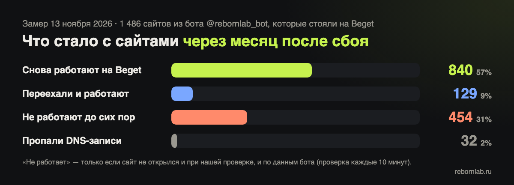
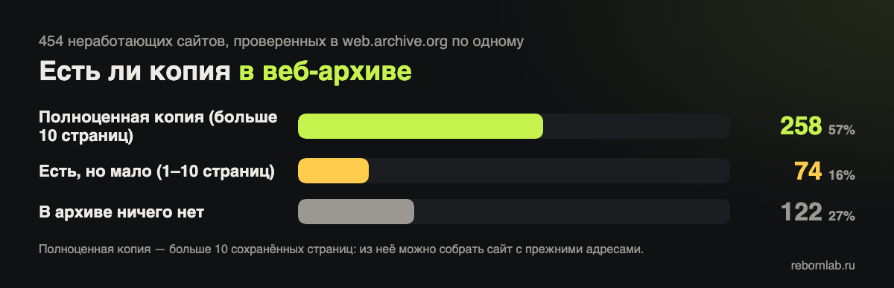
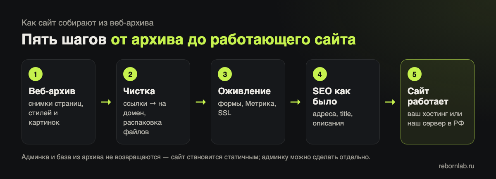

С начала ноября я каждый день смотрю на одни и те же цифры: сколько сайтов с Beget уже вернулось. Большинство — вернулось. Но есть хвост, который не уменьшается: сайты, которые так и показывают «Домен не прилинкован», ошибку 500 или не отвечают вовсе. Чаще всего у их владельцев нет своей копии — и кажется, что сайт потерян.

**Чаще всего — нет.** Если сайт хоть раз попадал в веб-архив, его можно собрать заново: с теми же адресами страниц, текстами и картинками. Ниже — сколько таких сайтов сейчас, как мы это посчитали, как проверить свой сайт и что именно получится вернуть.

## Что стало с сайтами Beget к 13 ноября

Исходные данные — наш бесплатный бот [@rebornlab_bot](https://t.me/rebornlab_bot): люди добавляют туда свои сайты, а бот следит, когда они заработают. Я взял все сайты, которые в момент добавления стояли на серверах Beget, — **1 486 сайтов** — и 13 ноября проверил каждый заново: куда сейчас указывает домен и что отвечает сайт.



| Что нашли | Сайтов |
|---|---|
| Снова работают на Beget | **840** |
| Переехали на другой хостинг и работают | **129** |
| Не работают до сих пор | **454** |
| — «Домен не прилинкован» | 259 |
| — ошибка сервера (500, 503 и другие) | 115 |
| — сервер не отвечает | 80 |
| У домена пропали DNS-записи | 32 |

«Не работает» я засчитывал строго: только если сайт не открылся и при моей проверке, и по данным бота, который проверяет его каждые 10 минут. Так случайный сбой не попадает в статистику.

## Есть ли у лежащих сайтов копия в архиве

Дальше — самое интересное. Каждый неработающий сайт я по одному проверил в веб-архиве (web.archive.org): сколько у него сохранено страниц и картинок и когда сделан последний снимок.



Из 454 проверенных сайтов **у 332 есть сохранённые страницы**, у **258 — больше десяти страниц**, то есть полноценная копия, из которой можно собрать сайт. У таких сайтов в архиве обычно (медиана) **449 страниц и 180 картинок**, а у 191 из 258 последний снимок сделан уже в 2026 году — то есть копия свежая.

### Как мы считали

Для тех, кто хочет повторить на своём сайте. У архива есть открытый интерфейс CDX — он отдаёт список всех сохранённых адресов сайта:

```
https://web.archive.org/cdx/search/cdx?url=мой-сайт.ru/*
    &filter=statuscode:200   # только страницы, которые открывались
    &collapse=urlkey         # каждый адрес один раз
    &fl=mimetype,timestamp   # тип файла и дата снимка
```

Строки с `text/html` — это страницы, с `image/...` — картинки, самая поздняя дата у страниц — последний снимок. Важно: архив не любит частые запросы и отвечает «503 — перегружен» или «429 — подождите». Поэтому я делал один запрос за раз с паузой в несколько секунд, и вся проверка заняла несколько часов. Своими сайтами так проверять удобно, чужими сотнями — только бережно.

## Как проверить свой сайт за минуту

1. Откройте [web.archive.org](https://web.archive.org/) и введите адрес сайта.
2. Если появился календарь с отметками — копии есть. Откройте самую свежую и пройдите по нескольким ссылкам: открываются ли внутренние страницы и картинки.
3. Или проверьте автоматически на странице [«Можно ли восстановить сайт»](/beget/vosstanovit/): она посчитает страницы и картинки в архиве и покажет дату последнего снимка.

Если в архиве только главная или снимок очень старый — восстановление будет неполным, и это лучше знать заранее. Подробно о том, что архив сохраняет хорошо, а что теряет, — в разборе [«Что на самом деле сохраняется в веб-архиве»](/journal/chto-sohranyaetsya-v-veb-arhive/).

## Как это устроено: от архива до работающего сайта



1. **Скачиваем снимки** — страницы, стили, картинки и документы за самую полную дату. Архив отдаёт файлы сжатыми, их нужно распаковать, иначе ломается оформление.
2. **Чиним ссылки.** В архиве все адреса переписаны на web.archive.org — возвращаем их на домен сайта.
3. **Оживляем то, что архив не умеет:** формы заявок снова присылают письма, подключаем Метрику, ставим SSL.
4. **Сохраняем SEO:** адреса страниц, заголовки и описания — как были, чтобы Яндекс и Google увидели тот же сайт, а не новый.
5. **Размещаем** — на хостинге владельца или на нашем сервере в России, и меняем у домена одну A-запись.

## Что восстанавливается, а что нет

**Возвращается:** страницы с их адресами (позиции в поиске не обнуляются), тексты, картинки, меню, внешний вид, документы, которые архив успел скачать.

**Не возвращается из архива:** админка и база данных — сайт становится «статичным»: править его можно, но не через старую панель. Личные кабинеты, корзина и оплата. Страницы, на которые архив не заходил.

Если админка нужна — её можно сделать отдельно, на WordPress или на родном движке, если у владельца сохранилась копия базы.

## Как это выглядит на реальных проектах

За ноябрь мы так вернули несколько сайтов, у владельцев которых не было ни копии, ни доступа к старому серверу. Названия не пишу — клиенты не обязаны светиться в чужом журнале:

- **Магазин тканей** — каталог с сотнями товарных страниц, собран из архива, заявки снова приходят на почту.
- **Производитель кабеля** — сайт на Битриксе без копии; вернули из архива, а когда Beget поднял оригинал, у владельца остались оба варианта.
- **Научный журнал** — выпуски и статьи, форма приёма рукописей с файлами работает заново.
- **Сайт компании на MODX** — восстановлен без базы данных, только по сохранённым страницам, затем перенесён на хостинг владельца.
- **Сайт услуг на WordPress** — перенесли оригинал с Beget, а то, чего не хватало, дополнили из архива.

Чаще всего владельцы удивляются срокам: им говорили «месяц-два». Когда копия в архиве хорошая, первую версию небольшого сайта обычно получается показать в тот же день. Большие сайты — дольше: там я сначала считаю страницы и файлы и только потом называю сроки.

## Что делать, если ваш сайт так и не вернулся

1. **Не ждите бесконечно.** Если сайт лежит больше недели, а поддержка не называет сроков, — проверьте копию в архиве, пока она есть.
2. **Проверьте домен.** Если он истекает, а продлить через Beget сейчас нельзя, — вот [разбор про домены](/journal/beget-domen-istekaet-prodlit-nelzya/).
3. **Сохраните, что есть.** Если панель Beget открывается — скачайте файлы и базу, даже если сайт не работает.
4. **Поставьте сайт на слежение** в [@rebornlab_bot](https://t.me/rebornlab_bot) — бесплатно. Бот напишет, как только сайт заработает.

Если разбираться самим некогда — напишите: посмотрю, что есть в архиве, и честно скажу, что получится вернуть. Подробнее — на странице [«Восстановление сайтов»](/vosstanovlenie-sajta/).
