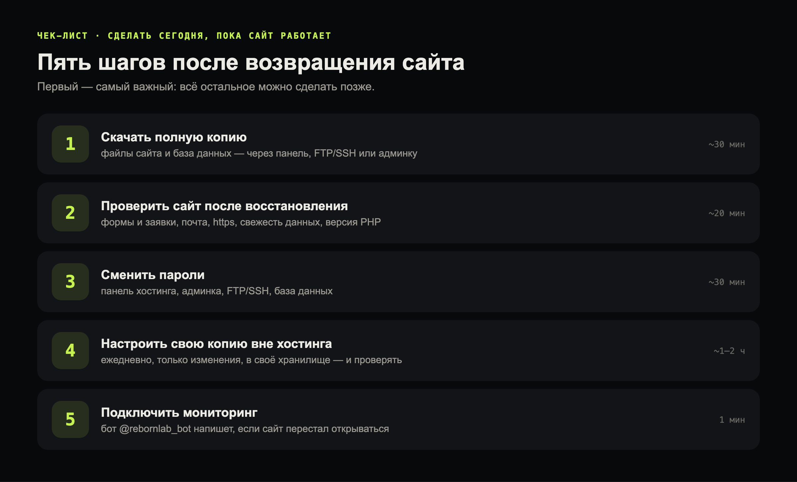
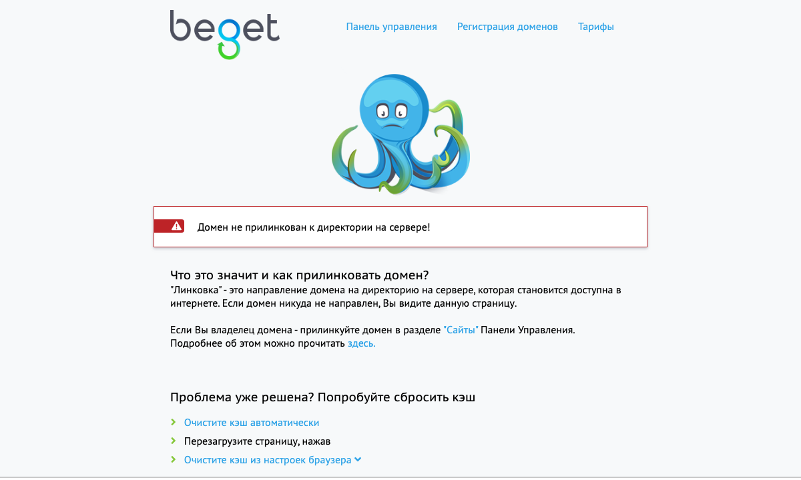
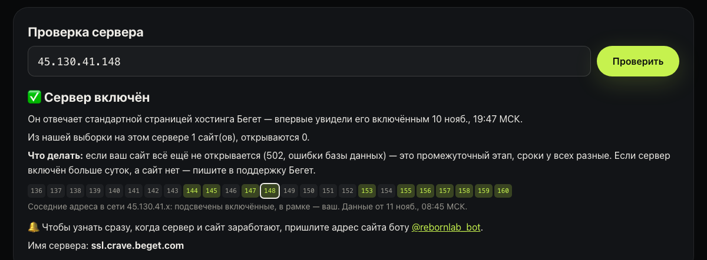
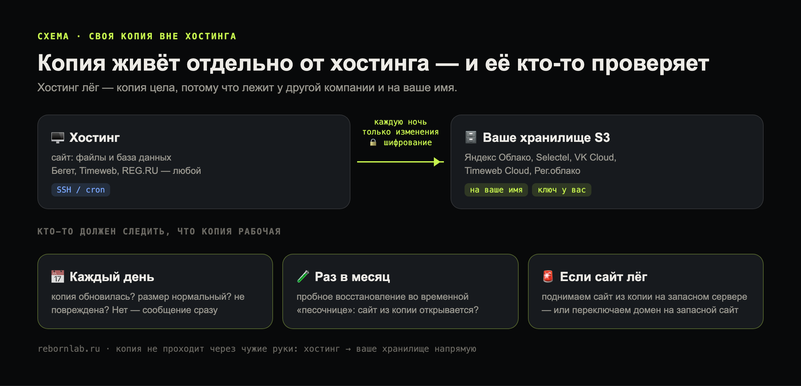
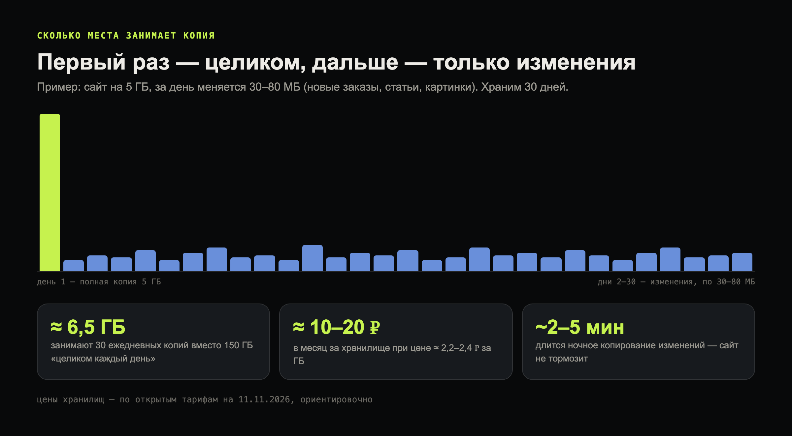
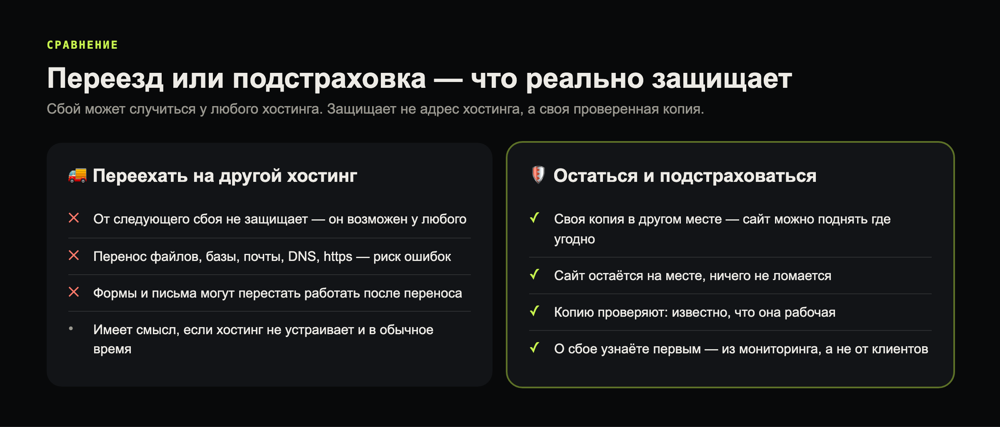

Бегет массово возвращает сайты: по нашим замерам, за сутки открылось вдвое больше сайтов из бота, чем днём раньше. И почти каждый, у кого сайт вернулся, спрашивает одно: переезжать ли теперь на другой хостинг? Наш ответ — **переезд не обязателен**. Сбой может случиться у любого хостинга, и переезд сам по себе от этого не защищает. Защищает другое: своя свежая копия в другом месте и понимание, что делать, если сайт снова перестанет открываться. Ниже — пять шагов, которые стоит сделать сегодня, пока сайт работает.



## 1. Скачайте полную копию сайта прямо сейчас

Пока сайт и панель работают, заберите себе файлы и базу данных. Это самый важный шаг — всё остальное можно сделать позже.

- **Через панель хостинга** — раздел резервных копий или файловый менеджер плюс выгрузка базы через phpMyAdmin.
- **Через админку сайта** — у WordPress и 1С-Битрикс есть свои инструменты резервного копирования. Так мы сняли копию сайта клиента на Битриксе: 2 ГБ файлов и база, 503 таблицы.
- **По SSH** — быстрее всего, если хостинг его даёт. Логин, пароль и имя сервера обычно есть в панели:

```bash
# подключиться к хостингу
ssh ЛОГИН@СЕРВЕР

# упаковать папку сайта (на Бегете это обычно ~/ваш-домен/public_html)
tar -czf site-$(date +%F).tar.gz ваш-домен/public_html

# выгрузить базу данных (имя базы и пользователя — в настройках сайта или в панели)
mysqldump -u ПОЛЬЗОВАТЕЛЬ_БД -p ИМЯ_БД | gzip > db-$(date +%F).sql.gz
```

А потом на своём компьютере забрать оба файла:

```bash
scp ЛОГИН@СЕРВЕР:~/site-*.tar.gz ЛОГИН@СЕРВЕР:~/db-*.sql.gz ~/Backups/
```

Храните копию **не у того же хостинга**: на компьютере, в облаке, на внешнем диске.

## 2. Проверьте сайт после восстановления

Сайты возвращают из резервных копий, и после этого не всё может работать так же, как раньше:

- **Формы и заявки** — отправьте тестовую заявку и убедитесь, что она дошла.
- **Почта** — письма с сайта и на ваш домен приходят?
- **https** — сертификат на месте, браузер не ругается?
- **Последние изменения** — копия может быть не самой свежей: проверьте новые товары, статьи, цены.
- **Версия PHP** — если сайт открывается с ошибкой, проверьте её в панели.

Если вместо сайта такая страница — сайт ещё не вернули на сервер или домен не привязался к папке сайта:



Бегет советует в этом случае проверить в панели, в разделе «Сайты», что домен привязан к нужной папке, и версию PHP; если не помогло — написать в поддержку. Включён ли сам сервер и сколько соседей по сети уже работает, видно на нашей странице [мониторинга серверов](/beget/server/):



## 3. Смените пароли

После любого инцидента у хостинга стоит сменить пароли от панели хостинга, админки сайта, FTP/SSH и базы данных. Это занимает полчаса и закрывает лишние риски.

## 4. Настройте свою копию вне хостинга

Разовая копия из шага 1 устареет через неделю. Надёжнее — автоматическая ежедневная копия в отдельное облачное хранилище, оформленное на вас:



Копировать каждый день целиком не нужно: программы резервного копирования вроде restic первый раз забирают сайт полностью, а дальше — только изменения, и шифруют всё вашим ключом. Пример для хранилища S3:

```bash
# один раз: ключи доступа к хранилищу и пароль шифрования
export AWS_ACCESS_KEY_ID=ваш_ключ AWS_SECRET_ACCESS_KEY=ваш_секрет
export RESTIC_PASSWORD=длинный_пароль_для_шифрования
restic -r s3:https://storage.yandexcloud.net/мой-бакет init

# каждую ночь: копия папки сайта и свежей выгрузки базы — только изменения
restic -r s3:https://storage.yandexcloud.net/мой-бакет backup ~/ваш-домен/public_html ~/db.sql.gz

# хранить 30 последних дней и проверять, что копия цела
restic -r s3:https://storage.yandexcloud.net/мой-бакет forget --keep-daily 30 --prune
restic -r s3:https://storage.yandexcloud.net/мой-бакет check
```

Запуск по расписанию — одна строка в планировщике (cron) хостинга, например каждую ночь в 3:30:

```bash
30 3 * * * /bin/bash ~/backup.sh >> ~/backup.log 2>&1
```

Сколько это занимает места и денег:



Где хранить — выбирайте любое российское облако с хранилищем S3. Цены ориентировочные, по открытым тарифам на 11 ноября 2026 года:

| Хранилище | ≈ цена за 1 ГБ в месяц | Особенность |
|---|---|---|
| Яндекс Облако | 2,2–2,4 ₽ | первый гигабайт каждый месяц бесплатно |
| Selectel | 2,3 ₽, холодное 1,1–1,25 ₽ | входящий трафик бесплатный |
| VK Cloud | 2,3 ₽, холодное 1,1 ₽ | холодное дешевле хранить, дороже скачивать |
| Timeweb Cloud | пакеты: 10 ГБ ≈ 79 ₽, 100 ГБ ≈ 349 ₽ | фиксированная цена за пакет |
| [Рег.облако](/go/reg-s3) | 2,2 ₽ | один кабинет с доменом REG.RU |

Главное, о чём забывают: **копию нужно проверять**. Копия, из которой ни разу не пробовали восстановить сайт, может оказаться нерабочей ровно тогда, когда она нужна. Хотя бы раз в месяц разверните её в отдельной папке или на тестовом сервере и откройте сайт.

## 5. Подключите мониторинг

Узнавать о сбое от клиентов — поздно. Бесплатный бот [@rebornlab_bot](https://t.me/rebornlab_bot) проверяет сайт каждые несколько минут и пишет в Telegram, если сайт перестал открываться и когда снова заработал.

## Переезд или подстраховка



Переезжать стоит, если хостинг не устраивает и в обычное время: скорость, поддержка, цены. Решать это лучше спокойно, а не сразу после сбоя. А своя проверенная копия нужна в любом случае — на любом хостинге.

## Если всё же решили переезжать

Переезд имеет смысл, если хостинг не устраивает и в обычное время. Сайты наших клиентов мы сами держим в России на серверах REG.RU. Что выбрать — зависит от сайта:

- **[Виртуальный хостинг REG.RU](/go/reg-hosting)** — для обычных сайтов на WordPress, 1С-Битрикс, MODX: панель управления, почта на домене, резервные копии.
- **[Облачный сервер Рег.облака](/go/reg-cloud)** — если нужен свой сервер с гибкой мощностью: её можно увеличить в любой момент, оплата за то, что используете.
- **[Выделенный сервер REG.RU](/go/reg-dedicated)** — для больших интернет-магазинов и нагруженных сайтов, когда нужен целый сервер.

Перенос — файлы, базу, почту, домен и https — можем сделать за вас, по возможности без перерыва в работе сайта. А своя копия вне хостинга (шаг 4) нужна и после переезда.

*Ссылки на REG.RU — партнёрские: если закажете по ним, REG.RU заплатит нам небольшое вознаграждение, для вас цена та же.*

## Если не хочется разбираться самому

Мы можем настроить всё за вас: ежедневную копию сайта в вашем собственном хранилище, проверку, что сайт из неё поднимается, мониторинг и запасной сайт на случай сбоя. Копии при этом хранятся у вас, а не у нас. Подробнее — на странице [«Страховка сайта»](/demo/strahovka/).
