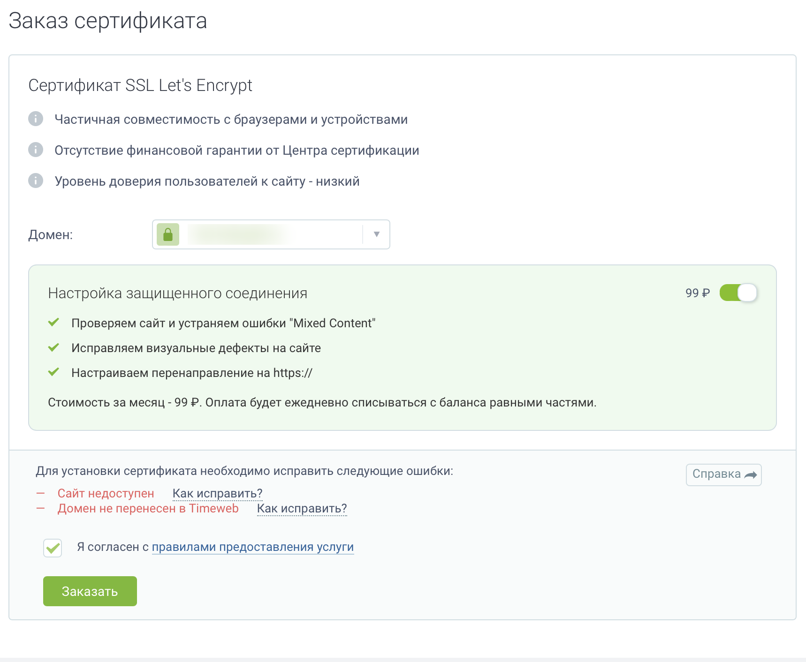
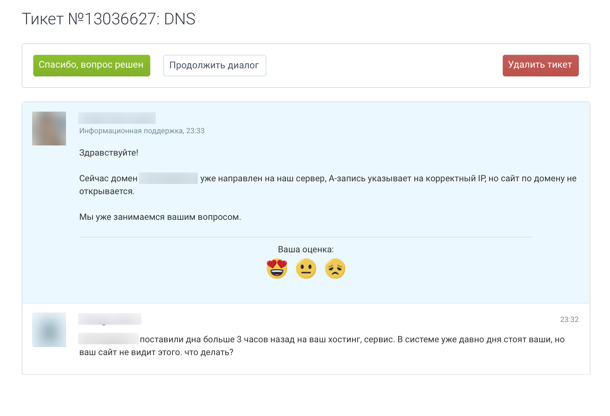
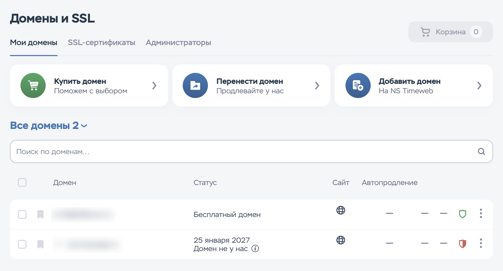

Коротко: мы перенесли готовый сайт клиента на виртуальный хостинг Timeweb за 15 минут. Ещё **7 часов** домен не открывался у части людей, а бесплатный сертификат так и не выпустился — из‑за настроек самого Timeweb, которые никто не объяснил. Причину нашли мы, а не поддержка. Ниже — всё по порядку, с фактами и временем, и чек‑лист, чтобы у вас было быстрее.

## Исходные данные

- Клиент — небольшая гостиница в центре Петербурга. Старый сайт лёг вместе с Beget после сбоя 2 ноября.
- Мы собрали новый сайт на WordPress с админкой в его стиле: номера, цены, бронирование TravelLine, отзывы, политика, Метрика.
- Клиент выбрал хостинг Timeweb (виртуальный хостинг) и купил тариф. Наша задача — перенести сайт и запустить на его домене. Почта клиента остаётся на Beget — её трогать нельзя.

## Хронология

| Время (МСК) | Что происходило |
|---|---|
| ~20:30 | Клиент купил хостинг. В письме — логин, пароль и IP |
| 20:45 | По FTP вход есть. По SSH — «доступ запрещён» с этими данными |
| 21:00 | После нескольких попыток входа Timeweb **заблокировал наш IP**. Без предупреждения. Заблокированы не только SSH, но и **все сайты на сервере** |
| 21:10 | Владелец включил SSH в панели. Пароль из письма к SSH так и не подходит |
| 21:20 | Подошёл **пароль от аккаунта** и логин **без суффикса** — нигде в письме этого нет |
| 21:22 | Веб‑консоль в панели: **вставка текста не работает** — ключ не добавить |
| 21:25 | Файлы сайта и база перенесены по SSH. Базу данных по SSH создать нельзя — только в панели |
| 21:30 | Сайт работает на сервере. Но по домену — **заглушка «Ваш аккаунт готов к работе»** |
| 21:35 | Оказалось: домен привязан к «Основному сайту», а папка с именем домена, которую Timeweb создал сам, — пустая и не используется |
| 23:32 | Тикет в поддержку: DNS обновлены 3 часа назад, сайт не виден |
| 23:33 | Ответ: «A‑запись указывает на корректный IP, но сайт не открывается. **Мы уже занимаемся**». Дальше — тишина |
| 00:30 | Заказ бесплатного сертификата в панели: «Сайт недоступен», «Домен не перенесён в Timeweb» |
| 01:10 | Независимая проверка из 12 стран: сайт **открывается** у 11 из 12. А у владельца — нет |
| 01:20 | **Нашли причину сами:** Timeweb по умолчанию прописал в DNS IPv6‑запись (AAAA), которая ведёт **на страницу‑парковку другого их сервера** |
| 01:30 | Удалили AAAA у домена. У www она осталась — удалили отдельно |
| 03:00 | Сертификат Timeweb всё ещё не выдаёт. Панель по‑прежнему пишет «домен не перенесён», у домена — красный щит и «Домен не у нас» |
| 03:30 | Сдались: перевели домен на свой сервер — https и сертификат выдаём сами, сайт остаётся на Timeweb |
| 03:45 | Четыре DNS‑сервера Timeweb отдают четыре разных ответа о том же домене — ждём, пока синхронизируются |
| 04:20 | Сертификат выпущен у нас, сайт работает по https. Через Timeweb — так и не выпустился |
| 04:50 | Timeweb заблокировал адрес нашего сервера — сайт снова «не отвечает». Обход: туннель через другой наш сервер + кэш |

## Что именно пошло не так

### 1. SSH: данные из письма не подходят

В письме — логин вида `cm…_rebornl` и пароль. Это доступ к FTP. Для SSH нужен логин **без суффикса** и **пароль от аккаунта**. Об этом не сказано ни в письме, ни в панели рядом с кнопкой «Включить SSH».

### 2. Блокировка без предупреждения — вместе с сайтами

После нескольких неудачных попыток Timeweb блокирует IP **целиком**: не только SSH, но и веб. Владелец открывает свой сайт — «не загружается». У остальных всё работает. Никакого письма или сообщения в панели нет. Человек думает, что сайт сломан.

### 3. Веб‑консоль без вставки

В панели есть консоль сервера, но вставить в неё текст нельзя. Набирать руками ключ в 100 символов — нереально. Единственный «аварийный» вход превращается в декорацию.

### 4. Две папки и «заглушка»

Timeweb создаёт папку с именем домена, но домен по умолчанию привязан к другой — «Основному сайту». Кладёшь файлы «куда логично» — видишь «Ваш аккаунт готов к работе».

### 5. Главное: IPv6 ведёт на «парковку»

В DNS домена Timeweb **сам** добавил запись AAAA (IPv6). Она указывает не на сервер с сайтом, а на парковочную страницу другого сервера.

Что это значит на практике:
- У кого есть IPv6 — а это большинство мобильных операторов в России — сайт **не открывается**: телефон идёт по IPv6 и попадает на заглушку.
- Let's Encrypt проверяет домен сначала по IPv6 — попадает на парковку — и **сертификат не выпускается**. Кнопка «Заказать сертификат» в панели самого Timeweb отвечает: «Сайт недоступен».
- Поддержка смотрит на A‑запись (IPv4), видит «корректный IP» — и «занимается».

### 6. Поддержка

«Мы уже занимаемся вашим вопросом» — и больше ничего за несколько часов. Причину, которая в их же DNS, нашли мы сами — проверкой с разных серверов и просмотром ответа по IPv6.

Ответ пришёл через минуту после вопроса и по сути повторил наш же вопрос другими словами. У нас сложилось впечатление, что первую линию отвечает автоматический помощник или шаблон — «чтобы отписаться»: вежливо, быстро и без единого шага к решению. Живого разбора DNS за ночь мы так и не дождались.

### Панель, в которой не найти нужное

Отдельная история — сама панель. Нужные вещи разбросаны по разным разделам: SSH включается в одном месте, база данных создаётся в другом, DNS домена — в третьем, сертификат — в четвёртом, привязка домена к папке — в пятом. Названия не подсказывают, что внутри, а ошибки вроде «Домен не у нас» или «Сайт недоступен» не объясняют, что с этим делать. Владелец сайта, который зашёл в панель впервые, по нашему опыту просто не понимает, куда нажать.

### 7. «Домен не у нас» — и сертификата нет

Даже после удаления IPv6‑записей и обновления DNS по всему миру панель Timeweb продолжала показывать у домена красный щит и статус «Домен не у нас». Домен зарегистрирован у другого регистратора — это нормальная ситуация, так у большинства клиентов. Но бесплатный сертификат панель так и не выпустила, и нигде не объяснено, что для «чужих» доменов это не работает или работает иначе. Сайт при этом открывался у всех по http — то есть хостинг его обслуживал, а защищённое соединение включить было нельзя.

### 8. Четыре DNS‑сервера — четыре разных ответа

Когда мы поменяли A‑записи в панели Timeweb, их собственные DNS‑серверы ещё долго отвечали по‑разному: два отдавали новый адрес для домена и старый для www, третий — старый для обоих, четвёртый — новый для обоих. Let's Encrypt спрашивает случайный из них — и проверка то проходит, то нет. Обычно серверы одного хостинга синхронизируются за минуты.

### 9. Платная «помощь»

При заказе бесплатного сертификата по умолчанию включена опция «Настройка защищённого соединения» — **99 ₽ в месяц**. Перенаправление на https и исправление «смешанного содержимого» на WordPress делается за минуту и бесплатно.

## Как мы обошли проблему — и почему обычный человек так не сделает

Чтобы получить сертификат, пришлось фактически обойти хостинг. Вот что мы сделали:

1. **Нашли причину сами**: проверили домен из 12 стран, посмотрели ответы по IPv4 и IPv6 отдельно и увидели, что IPv6 ведёт на парковку другого сервера Timeweb.
2. **Удалили их IPv6‑записи** у домена и у www — вручную, в панели DNS.
3. **Подняли на своём сервере «прослойку»** (обратный прокси): посетитель приходит к нам, а мы незаметно передаём запрос сайту на Timeweb. Сайт, база и админка остаются у клиента на его хостинге.
4. **Перенаправили домен на свой сервер** — поменяли A‑записи в панели Timeweb.
5. **Дождались, пока синхронизируются четыре DNS‑сервера Timeweb** — они долго отдавали разные адреса, а Let's Encrypt спрашивает случайный.
6. **Выпустили сертификат Let's Encrypt у себя** — на домен и на www.
7. **Научили WordPress понимать, что он работает по https** за прокси (одна строка в конфигурации), заменили адреса во всей базе с http на https, убрали временные настройки.
8. **Проверили результат снаружи** — из десяти стран, включая Россию: сайт открывается по https, http и www перенаправляются куда надо.

Почта клиента на Beget при этом не тронута.

### И даже так — блокировка

Через полчаса после запуска https сайт снова перестал открываться: страница грузилась 60 секунд и падала с ошибкой, а наш же мониторинг прислал «komnatyspb.ru сейчас не работает: сервер не отвечает». Причина — Timeweb **заблокировал адрес нашего сервера**, через который шли посетители. Для хостинга все гости сайта выглядели как один адрес — и его просто отрезали. Без уведомления, без объяснения.

Пришлось строить обход обхода: пустить запросы к Timeweb через ещё один наш сервер по закрытому туннелю и включить у себя кэш, чтобы лишний раз к хостингу не ходить. Сайт заработал и даже стал быстрее: страница отдаётся примерно за полсекунды. Но факт остаётся фактом — хостинг мешает работать даже тогда, когда ты уже всё сделал за него.

Честно: **человек без технических знаний этого не сделает никогда.** Он увидит в панели «Сайт недоступен» и «Домен не у нас», напишет в поддержку, получит «мы занимаемся» — и останется без защищённого соединения, с предупреждением «Не защищено» в браузере у каждого посетителя. А часть людей — с мобильным интернетом — вообще не увидит сайт.

## Чек‑лист: что проверить после переезда на любой хостинг

1. **IPv6 (AAAA).** Есть ли AAAA у домена и у www, и куда она ведёт. Если хостинг не обслуживает сайт по IPv6 — удалить.
2. **Куда привязан домен** в панели — в какую папку. Класть файлы туда.
3. **SSH.** Какие логин и пароль нужны именно для SSH, не путать с FTP.
4. **Не подбирать пароль.** После 3–5 ошибок многие хостинги блокируют IP вместе с сайтами.
5. **Почта.** Записи MX, SPF, DKIM — сверить со старыми до смены DNS.
6. **Сертификат.** Если панель не выпускает — смотреть AAAA и кэш DNS, не платить за «настройку».
7. **Проверка снаружи.** Открывать сайт не только у себя: кэш DNS и блокировки обманывают. Сервисы проверки из разных стран показывают правду.

## Чему мы научились за эти дни (и что теперь делаем за клиента)

- **Автопилот запуска домена.** Клиент меняет DNS — наш сервер сам видит это, выпускает сертификат, включает https и присылает уведомление в Telegram. Без ручных шагов.
- **https через свой сервер**, если хостинг не справляется — как в этом случае.
- **Перенос WordPress на хостинг клиента** — файлы, база, замена адресов, проверка — за 15 минут.
- **Восстановление сайта из веб‑архива в его родном дизайне** — с теми же адресами страниц, текстами, картинками, PDF, Метрикой и формами заявок. Сотни страниц — за вечер.
- **Бережная закачка с нескольких серверов**, чтобы веб‑архив не блокировал, а серверы не перегружались.
- **Уведомления клиенту в Telegram‑боте**: «сайт заработал», «сайт перестал открываться».
- **Заявки с сайта** — на почту клиента, с защитой от спама.

## Итог

Сам перенос занял 15 минут. Всё остальное время ушло на то, чтобы хостинг показал сайт людям. Если вы переезжаете — пройдите чек‑лист выше. А если не хочется разбираться с AAAA, блокировками и сертификатами — напишите нам, сделаем под ключ и проследим, чтобы сайт открывался у всех.

**Моя личная оценка этого хостинг‑провайдера — 1 из 10.**
